# 中国 50 个一生必去的地方 · 门票与观光车价格全核验

> **50 处代表目的地 · 旺季票价与必要区间交通逐项核验** · 数据截至 **2026 年 10 月 13 日**

---

## 一、速览

| 指标 | 数值 |
|---|---|
| 代表目的地 | **50 处**（5 大地理区 × 10 处） |
| 平均基础成本 | **¥135.7 / 人**（门票＋必要观光车） |
| 需必乘观光车 | **29 处** |
| 无大门票 | **4 处**（西湖、八大关、凤凰古城、桂林—阳朔峰林） |
| 最高单项 | **¥280**（婺源古村落群、九寨沟） |
| 核验截止 | 2026-10-13 |

**三条口径，先讲清楚：**

1. **价格** —— 「基础成本」＝ **旺季大门票 + 必要区间交通**（观光车／环保车／摆渡船），均为成人全价、人民币元/人。索道、游船、竹筏、演出、保险一律归入「可选」，不计入合计。
2. **旺季** —— 优先采用景区公示的旺季价；平台只显示当前售价、无旺淡季之分的，采用当前价并在备注中注明。促销折扣、双人票折算、限时特惠**一律不采用**。
3. **榜单** —— 《中国国家地理》或美国《国家地理》均未发布过可回溯原刊的「中国 50 个一生必去景点」官方榜单。本清单以 2005 年《中国国家地理》「选美中国」体系为底本重建，价格部分则全部来自可核验的公开渠道。

---

## 二、50 地旺季票价总览

| # | 景点 | 具体地点 | 旺季门票 | 观光车 | 基础合计 | 价格来源 |
|---|---|---|---|---|---|---|
| 1 | **长白山天池** | 吉林延边州安图县与白山市抚松县交界 | 105 | 120 | **¥225** | 长白山官方收费公示 |
| 2 | **呼伦贝尔草原** | 内蒙古呼伦贝尔市陈巴尔虎旗、额尔古纳市一带 | 65 | — | **¥65** | 呼伦贝尔市发改委 · 同程 |
| 3 | **扎龙国家级自然保护区** | 黑龙江齐齐哈尔市铁锋区 | 73 | 含摆渡车 | **¥73** | 携程在售联票 |
| 4 | **大兴安岭北部兴安落叶松林** | 内蒙古根河市、额尔古纳市及黑龙江漠河市、塔河县一带 | 150 | — | **¥150** | 携程 |
| 5 | **盘锦红海滩** | 辽宁盘锦市大洼区、辽东湾沿岸湿地 | 108 | 35 | **¥143** | 携程 · 同程 |
| 6 | **八达岭—慕田峪长城** | 北京市延庆区、怀柔区 | 40 | — | **¥40** | 携程 |
| 7 | **承德避暑山庄及周围寺庙** | 河北承德市双桥区 | 130 | — | **¥200** | 携程 |
| 8 | **泰山** | 山东泰安市 | 115 | 40 | **¥155** | 携程 |
| 9 | **青岛八大关** | 山东青岛市市南区 | 免费 | — | 免费 | 携程 · 同程 |
| 10 | **故宫博物院** | 北京市东城区景山前街 4 号 | 60 | — | **¥60** | 故宫博物院官方票务 |
| 11 | **黄山** | 安徽黄山市黄山区 | 190 | 38 | **¥228** | 黄山风景区管理委员会 · 安徽省发改委 |
| 12 | **千岛湖** | 浙江杭州市淳安县 | 130 | 65 | **¥195** | 淳安县人民政府 · 携程 |
| 13 | **西湖** | 浙江杭州市西湖区 | 免费 | 免费 | 免费 | 杭州市政府收费公园名录 · 携程 |
| 14 | **苏州古典园林** | 江苏苏州市 | 80 | — | **¥80** | 苏州市园林和绿化管理局 · 携程 |
| 15 | **乌镇** | 浙江嘉兴市桐乡市 | 110 | 免费 | **¥110** | 乌镇旅游官方商城 · 携程 |
| 16 | **婺源古村落群** | 江西上饶市婺源县 | 150 | 130 | **¥280** | 婺源乡村文旅 · 携程 |
| 17 | **三清山** | 江西上饶市玉山县 | 120 | 125 | **¥245** | 三清山景区公告 · 携程 |
| 18 | **武夷山** | 福建南平市武夷山市 | 免门票 | 95 | **¥95** | 南平市人民政府 · 福建省政府公报 |
| 19 | **普陀山** | 浙江舟山市普陀区普陀山岛 | 160 | 60 | **¥220** | 舟山市人民政府 · 普陀山一码通 |
| 20 | **鼓浪屿** | 福建厦门市思明区 | 免费 | 70 | **¥70** | 屿见厦门轮渡 · 携程 |
| 21 | **武陵源风景名胜区** | 湖南张家界市武陵源区 | 165 | 72 | **¥237** | 张家界市政府 · 发改部门 |
| 22 | **凤凰古城** | 湖南湘西土家族苗族自治州凤凰县沱江镇 | 免费 | — | 免费 | 携程 |
| 23 | **桂林—阳朔峰林** | 广西桂林市阳朔县一带 | 免费 | — | 免费 | 携程 |
| 24 | **德天瀑布** | 广西崇左市大新县硕龙镇中越边境 | 80 | 35 | **¥115** | 崇左市政府 · 大新县政府 |
| 25 | **黄姚古镇** | 广西贺州市昭平县黄姚镇 | 88 | — | **¥88** | 贺州市文化广电和旅游局 |
| 26 | **万峰林** | 贵州黔西南州兴义市 | 70 | 50 | **¥120** | 贵州省人民政府 · 贵州省发改委 |
| 27 | **罗平峰林与九龙瀑布** | 云南曲靖市罗平县 | 65 | — | **¥65** | 罗平官方攻略 · 携程 |
| 28 | **丹霞山** | 广东韶关市仁化县 | 100 | 免费 | **¥100** | 韶关市人民政府 · 丹霞山景区 |
| 29 | **海陵岛** | 广东阳江市江城区海陵岛 | 49 | — | **¥49** | 阳江海陵岛试验区政务网站 |
| 30 | **大嵛山岛** | 福建宁德市福鼎市 | 40 | 56 | **¥96** | 福鼎官方媒体 · 携程 |
| 31 | **九寨沟** | 四川阿坝藏族羌族自治州九寨沟县 | 190 | 90 | **¥280** | 九寨沟风景名胜区管理局 · 人民网四川 |
| 32 | **黄龙** | 四川阿坝藏族羌族自治州松潘县 | 170 | — | **¥170** | 黄龙景区官方公众号 · 人民网四川 |
| 33 | **稻城亚丁** | 四川甘孜藏族自治州稻城县香格里拉镇 | 146 | 120 | **¥266** | 稻城亚丁景区公告 · 四川日报 |
| 34 | **贡嘎山与子梅垭口观景区** | 四川甘孜州康定市、泸定县、九龙县一带 | 90 | 70 | **¥160** | 海螺沟景区管委会 · 四川广播电视台 |
| 35 | **四姑娘山** | 四川阿坝藏族羌族自治州小金县日隆镇 | 80 | 70 | **¥150** | 阿坝旅游网 · 四姑娘山景区管理局 |
| 36 | **雅鲁藏布大峡谷** | 西藏林芝市米林市派镇一带 | 150 | 90 | **¥240** | 西藏米林文旅官方公众号 · 携程 |
| 37 | **林芝桃花与波密岗乡云杉林** | 西藏林芝市巴宜区、波密县 | 30 | — | **¥30** | 西藏权威媒体 · 渠道攻略 |
| 38 | **南迦巴瓦峰** | 西藏林芝市米林市、波密县交界 | 150 | 90 | **¥240** | 西藏米林文旅官方公众号 · 携程 |
| 39 | **喀拉峻与那拉提草原** | 新疆伊犁州特克斯县、新源县 | 95 | 180 | **¥275** | 新疆维吾尔自治区发改委 · 那拉提景区 |
| 40 | **巴音布鲁克与九曲十八弯** | 新疆巴音郭楞蒙古自治州和静县 | 65 | 62 | **¥127** | 巴音布鲁克景区官方申明（2026.6） |
| 41 | **青海湖** | 青海海南州共和县、海北州刚察县与海晏县环湖区域 | 190 | 含观光车 | **¥190** | 携程 |
| 42 | **祁连山草原** | 青海海北州祁连县、甘肃张掖市肃南县一带 | 60 | 20 | **¥80** | 祁连县文体旅游广电局 |
| 43 | **张掖丹霞** | 甘肃张掖市临泽县、肃南裕固族自治县交界 | 54 | 20 | **¥74** | 澎湃新闻转景区官方票务说明 |
| 44 | **嘉峪关关城** | 甘肃嘉峪关市 | 110 | 16 | **¥126** | 甘肃政务服务网 · 携程 |
| 45 | **鸣沙山—月牙泉** | 甘肃敦煌市 | 110 | — | **¥110** | 携程 · 同程 |
| 46 | **莫高窟** | 甘肃敦煌市 | 238 | 含摆渡 | **¥238** | 莫高窟参观预约网官方公众号 |
| 47 | **天山天池** | 新疆昌吉回族自治州阜康市 | 95 | 60 | **¥155** | 同程 |
| 48 | **喀纳斯** | 新疆阿勒泰地区布尔津县禾木哈纳斯蒙古民族乡 | 160 | 70 | **¥230** | 喀纳斯景区官方公众号 |
| 49 | **禾木村** | 新疆阿勒泰地区布尔津县禾木哈纳斯蒙古民族乡 | 50 | 25 | **¥75** | 喀纳斯景区官方公众号 |
| 50 | **轮台胡杨林** | 新疆巴音郭楞蒙古自治州轮台县塔里木河流域 | 40 | 25 | **¥65** | 携程 |

> 「—」表示无此项或不单独售卖；「免费」表示无大门票；「含摆渡车／含观光车」表示票价已包含，不另收。

---

## 三、东北 · 华北（1—10）

**景观季节性极强，宜从春末到秋季组织 10—14 天长线；高纬景观冬季存在道路、低温与开放边界，不宜一次串联。**

*交通建议：北京、海拉尔、长春、青岛为枢纽，采用「飞机进、火车与租车衔接」通常比全程自驾更省力。*

### 1. 长白山天池

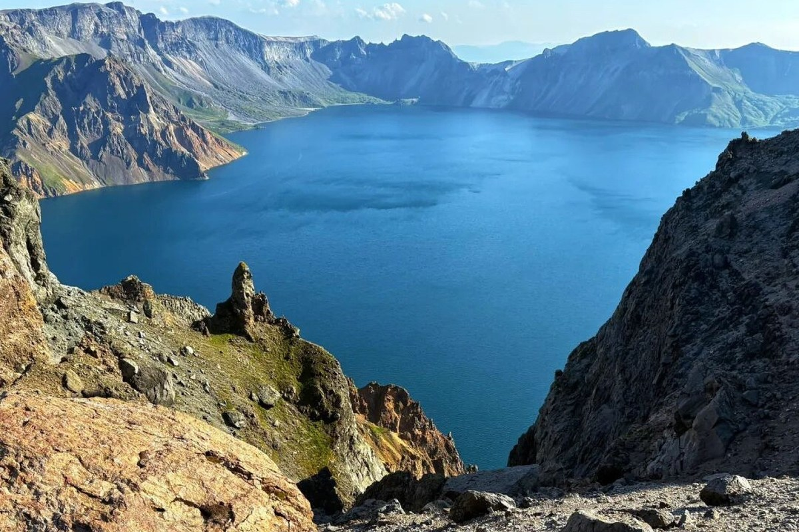

| 项目 | 内容 |
|---|---|
| **具体地点** | 吉林延边州安图县与白山市抚松县交界 |
| **景观类型** | 火山口湖 |
| **最佳时间** | 6月下旬—9月中旬；冬季仅适合有经验的冰雪旅行者 |
| **交通推荐** | 飞长白山机场、长春龙嘉或延吉朝阳川机场；高铁至长白山站或敦化站转景区巴士 |
| **旺季门票** | **105 元** |
| **必要观光车** | 120 元 |
| **基础合计** | **¥225** |
| **可选项目** | 天池主峰倒站车（天气允许时前往主峰观景台需另乘） |
| **价格来源** | 长白山官方收费公示 |

- **核验备注：** 北景区旺季首道门票 105 元；山门内环保大巴 85 元＋上主峰倒站车 80 元，合计约 120 元进山交通
- **避坑提示：** 天池开放取决于天气与道路，「到长白山」不等于「必见天池」；建议住二道白河镇

### 2. 呼伦贝尔草原

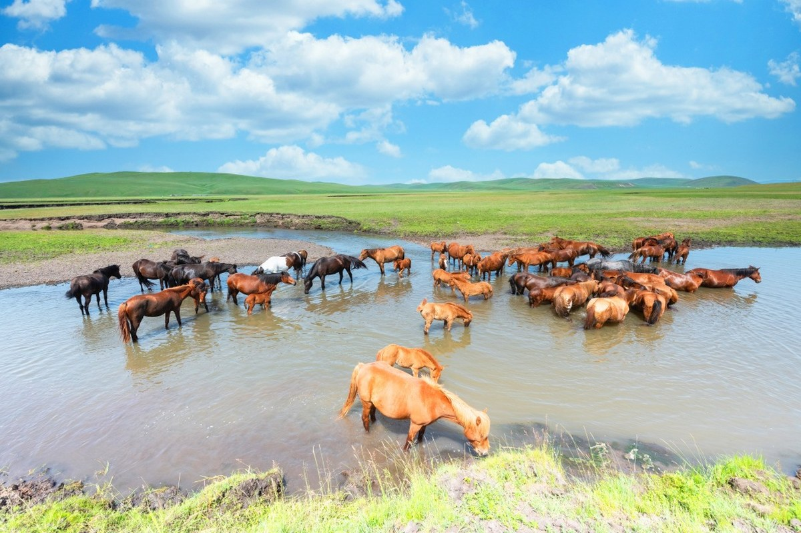

| 项目 | 内容 |
|---|---|
| **具体地点** | 内蒙古呼伦贝尔市陈巴尔虎旗、额尔古纳市一带 |
| **景观类型** | 草原 |
| **最佳时间** | 6月中旬—8月中旬草最盛；9月下旬—10月上旬秋色 |
| **交通推荐** | 飞海拉尔东山机场，高铁至海拉尔或满洲里，当地包车优于频繁换乘 |
| **旺季门票** | **65 元** |
| **必要观光车** | —（无强制区间交通） |
| **基础合计** | **¥65** |
| **可选项目** | 额尔古纳湿地观光车 12 元；莫日格勒河观光车 35 元（均自愿） |
| **价格来源** | 呼伦贝尔市发改委 · 同程 |

- **核验备注：** 草原主体无统一首道门票，以额尔古纳湿地景区 65 元为代表收费点
- **避坑提示：** 夏季蚊虫较多；边境线附近不得航拍或越界

### 3. 扎龙国家级自然保护区

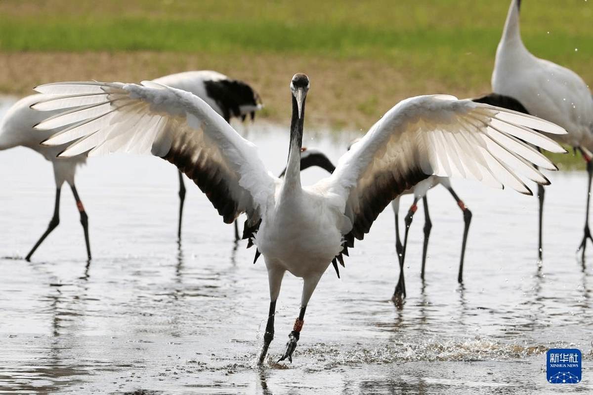

| 项目 | 内容 |
|---|---|
| **具体地点** | 黑龙江齐齐哈尔市铁锋区 |
| **景观类型** | 湿地 |
| **最佳时间** | 4月下旬—10月，丹顶鹤繁育与放飞随季节变化 |
| **交通推荐** | 飞齐齐哈尔或高铁至齐齐哈尔南站，再转公交、出租或包车 |
| **旺季门票** | **73 元** |
| **必要观光车** | —（无强制区间交通） |
| **基础合计** | **¥73** |
| **可选项目** | 游船项目以现场公示为准 |
| **价格来源** | 携程在售联票 |

- **核验备注：** 门票与摆渡车以联票形式在售，成人约 73 元；未能拆分出独立门票正价，故按可购联票计
- **避坑提示：** 观鹤时间以保护区当日安排为准，不应假定每日固定时段都有放飞

### 4. 大兴安岭北部兴安落叶松林

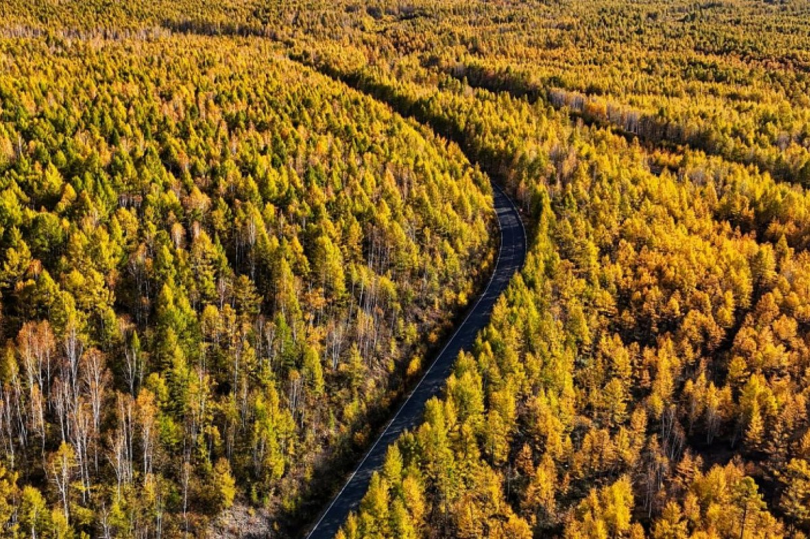

| 项目 | 内容 |
|---|---|
| **具体地点** | 内蒙古根河市、额尔古纳市及黑龙江漠河市、塔河县一带 |
| **景观类型** | 森林 |
| **最佳时间** | 6—8月；9月中旬—10月上旬秋色；冬季极寒体验 |
| **交通推荐** | 飞漠河古莲机场，夏季更常由海拉尔或加格达奇进入；林区自驾须备离线地图与充足燃油 |
| **旺季门票** | **150 元** |
| **必要观光车** | —（无强制区间交通） |
| **基础合计** | **¥150** |
| **可选项目** | 北极村游船 133 元（可选） |
| **价格来源** | 携程 |

- **核验备注：** 林区无统一门票，以漠河北极村旺季门票 150 元为代表收费点
- **避坑提示：** 蚊虫、防火期、无信号路段与野生动物均是风险

### 5. 盘锦红海滩

| 项目 | 内容 |
|---|---|
| **具体地点** | 辽宁盘锦市大洼区、辽东湾沿岸湿地 |
| **景观类型** | 海岸湿地 |
| **最佳时间** | 9月中旬—10月，碱蓬草颜色随年份水情与气温变化 |
| **交通推荐** | 飞大连、沈阳或锦州转高铁至盘锦，再租车或包车；景区内依赖观光车 |
| **旺季门票** | **108 元** |
| **必要观光车** | 35 元 |
| **基础合计** | **¥143** |
| **可选项目** | 自驾入园另按车型收费 |
| **价格来源** | 携程 · 同程 |

- **核验备注：** 门票 108 元＋观光车 35 元＝143 元；景区可驾车入园，观光车非强制但廊道较长时基本必乘
- **避坑提示：** 不要为拍摄离开栈道或进入养殖与保护区域

### 6. 八达岭—慕田峪长城

| 项目 | 内容 |
|---|---|
| **具体地点** | 北京市延庆区、怀柔区 |
| **景观类型** | 长城 |
| **最佳时间** | 春秋两季最舒适；冬季雪景独特但需防范结冰与大风 |
| **交通推荐** | 市郊铁路 S2 线、公交专线或包车；八达岭高铁站与自驾均方便 |
| **旺季门票** | **40 元** |
| **必要观光车** | —（无强制区间交通） |
| **基础合计** | **¥40** |
| **可选项目** | 八达岭单程索道/地面缆车 95 元、往返 180 元；慕田峪单程缆车 100 元 |
| **价格来源** | 携程 |

- **核验备注：** 八达岭旺季 40 元（慕田峪平台价 45 元）；两坡独立售票，取其一即可
- **避坑提示：** 不要只按「人多」判断，慕田峪、金山岭更适合分段安排

### 7. 承德避暑山庄及周围寺庙

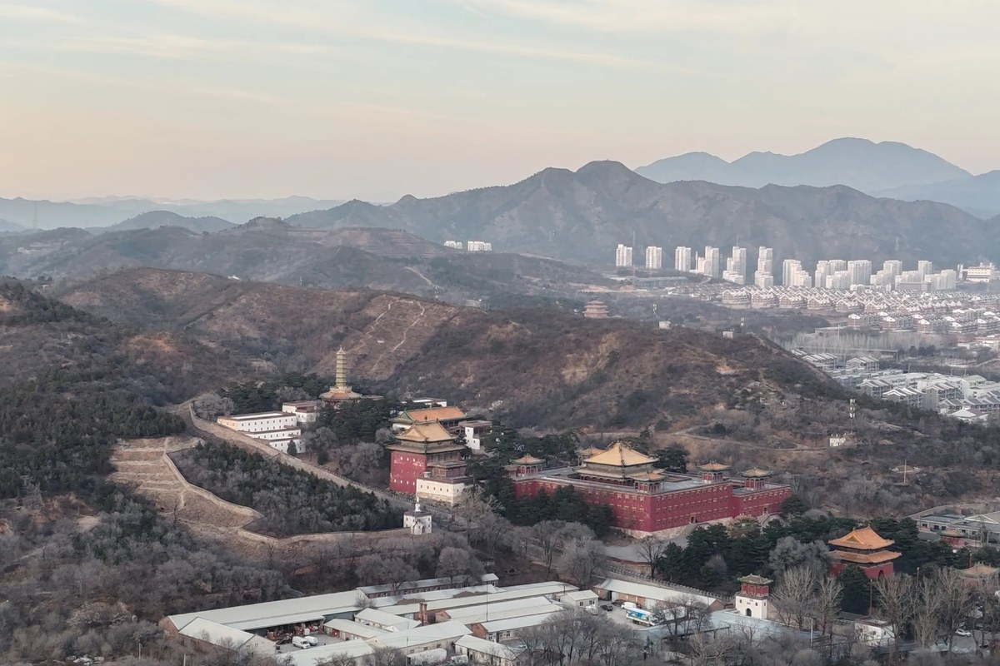

| 项目 | 内容 |
|---|---|
| **具体地点** | 河北承德市双桥区 |
| **景观类型** | 皇家园林 |
| **最佳时间** | 4月下旬—10月最适宜；冬季可看雪景但部分区域开放有限 |
| **交通推荐** | 高铁至承德南站，或飞北京后陆路前往 |
| **旺季门票** | **130 元** |
| **必要观光车** | —（无强制区间交通） |
| **基础合计** | **¥200** |
| **可选项目** | 普陀宗乘之庙＋须弥福寿之庙 80 元；普宁寺 60 元；磬锤峰 25 元 |
| **价格来源** | 携程 |

- **核验备注：** 无全含外八庙联票，按「山庄 130＋外庙 80＝200 元」的常见组合计
- **避坑提示：** 避暑山庄与外围寺庙群宜分两天，清晨与傍晚更适合湖区

### 8. 泰山

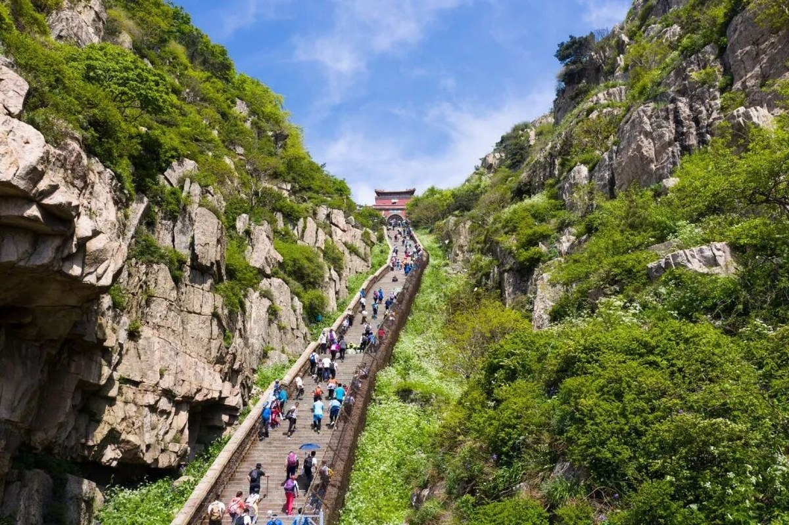

| 项目 | 内容 |
|---|---|
| **具体地点** | 山东泰安市 |
| **景观类型** | 名山 |
| **最佳时间** | 3月下旬—5月、9—11月；夏季多雨、冬季可能结冰 |
| **交通推荐** | 高铁至泰安站，市区公交至红门或天外村；红门线徒步、天外村线接驳中天门 |
| **旺季门票** | **115 元** |
| **必要观光车** | 40 元 |
| **基础合计** | **¥155** |
| **可选项目** | 中天门—桃花源索道 100 元；岱庙 20 元；封禅大典演出 168 元起 |
| **价格来源** | 携程 |

- **核验备注：** 旺季大门票 115 元；天外村—中天门旅游车单程 40 元（走天外村线需购，红门徒步线可省）
- **避坑提示：** 夜爬须确认天气、封山与装备要求，观日出不是必然结果

### 9. 青岛八大关

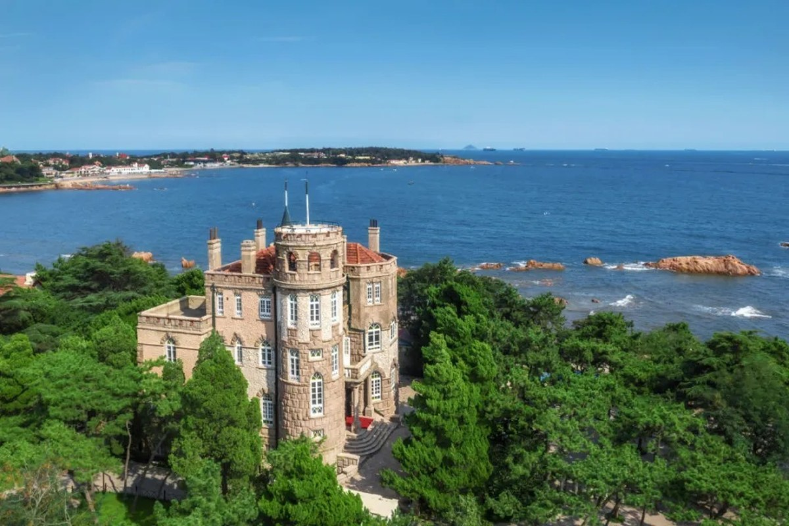

| 项目 | 内容 |
|---|---|
| **具体地点** | 山东青岛市市南区 |
| **景观类型** | 历史街区 |
| **最佳时间** | 5—10月，春季赏花、夏季海滨人流集中 |
| **交通推荐** | 飞青岛胶东机场或高铁至青岛站；老城区步行、公交、地铁结合 |
| **旺季门票** | **免费 元** |
| **必要观光车** | —（无强制区间交通） |
| **基础合计** | **免费** |
| **可选项目** | 德国总督楼旧址博物馆 20 元；花石楼单独收费 |
| **价格来源** | 携程 · 同程 |

- **核验备注：** 八大关为开放街区，无大门票；仅个别老建筑另收门票
- **避坑提示：** 海边风大，夏季不要只按晴天安排行程

### 10. 故宫博物院

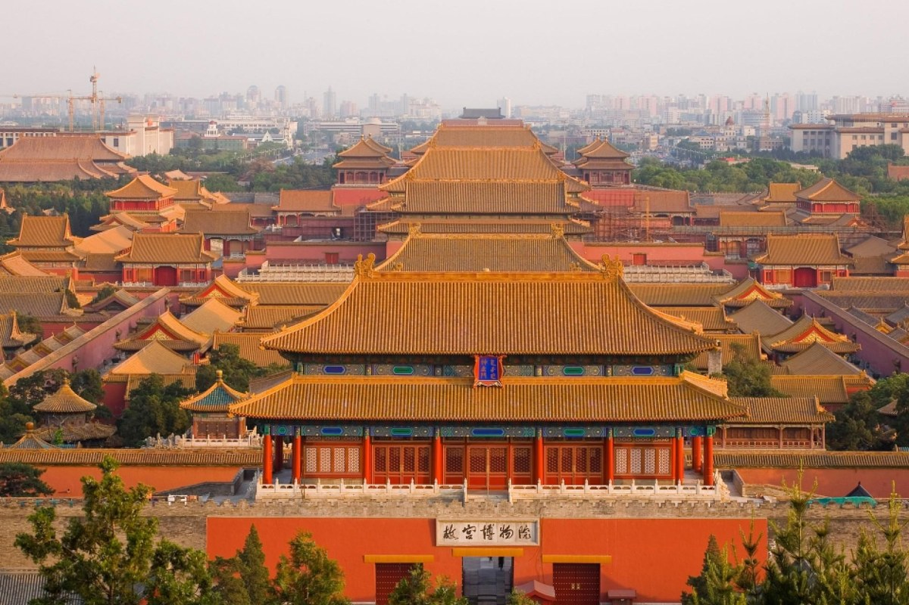

| 项目 | 内容 |
|---|---|
| **具体地点** | 北京市东城区景山前街 4 号 |
| **景观类型** | 宫殿建筑群 |
| **最佳时间** | 3月下旬—5月、9—10月最舒适；冬季人少但寒冷 |
| **交通推荐** | 高铁或飞机抵京，地铁天安门东、天安门西站步行可达 |
| **旺季门票** | **60 元** |
| **必要观光车** | —（无强制区间交通） |
| **基础合计** | **¥60** |
| **可选项目** | 珍宝馆 10 元；钟表馆 10 元 |
| **价格来源** | 故宫博物院官方票务 |

- **核验备注：** 旺季大门票 60 元（淡季 40 元）；午门单向进入，园内无必需付费交通
- **避坑提示：** 实行预约制，上午场常较拥挤，应按官方开放时间提前预约

---

## 四、华东（11—20）

**中国高铁网络最成熟、最适合一次串联名山、湖泊与古镇的区域，但热门目的地之间有明显的季节窗口。**

*交通建议：以上海、杭州、南京、合肥、南昌、福州为枢纽；关键是先固定「交通换乘节点」和「山岳入口」，而不是把景点排满。*

### 11. 黄山

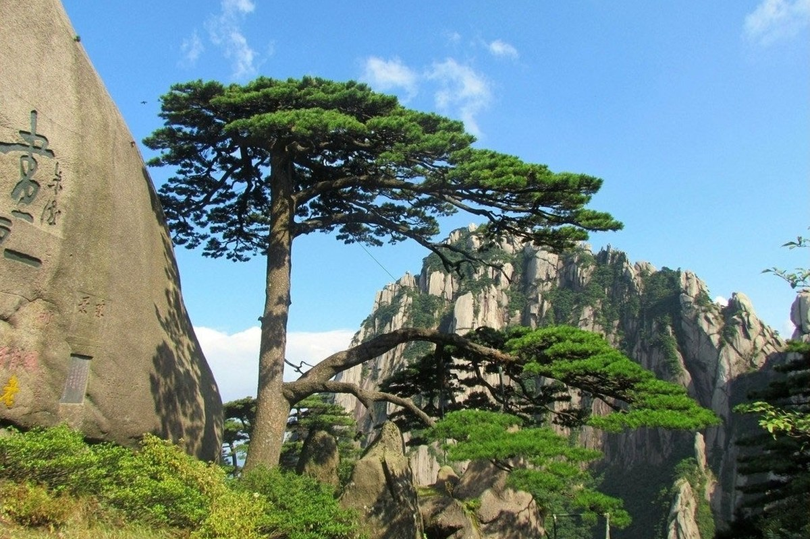

| 项目 | 内容 |
|---|---|
| **具体地点** | 安徽黄山市黄山区 |
| **景观类型** | 花岗岩峰林 |
| **最佳时间** | 4—6月、9—11月；冬季适合赏雪景与云海 |
| **交通推荐** | 飞黄山屯溪国际机场或高铁至黄山北站转景区专线；南、北、西大门入口不同 |
| **旺季门票** | **190 元** |
| **必要观光车** | 38 元 |
| **基础合计** | **¥228** |
| **可选项目** | 云谷/太平索道单程 80 元；玉屏 90 元；西海大峡谷缆车 100 元 |
| **价格来源** | 黄山风景区管理委员会 · 安徽省发改委 |

- **核验备注：** 平旺季门票 190 元（1.21—12.19）；换乘大巴单程 19 元往返 38 元，私家车禁入，属必须
- **避坑提示：** 订酒店前必须先确定登山方向；门票支持三日多次入园但须按规则激活

### 12. 千岛湖

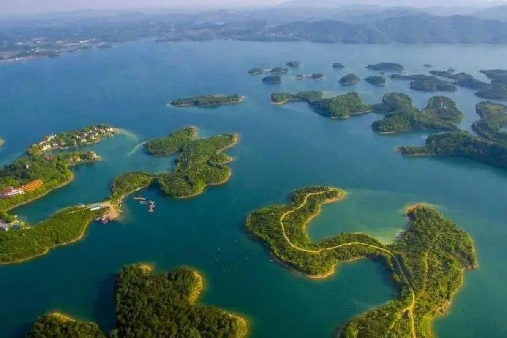

| 项目 | 内容 |
|---|---|
| **具体地点** | 浙江杭州市淳安县 |
| **景观类型** | 湖泊 |
| **最佳时间** | 4—10月适合环湖与水上项目；秋季骑行，冬季人少 |
| **交通推荐** | 飞杭州萧山机场或高铁至千岛湖站、杭州东站，再转车或租车 |
| **旺季门票** | **130 元** |
| **必要观光车** | 65 元 |
| **基础合计** | **¥195** |
| **可选项目** | 豪华休闲游含餐 218 元；上舱船票 98 元 |
| **价格来源** | 淳安县人民政府 · 携程 |

- **核验备注：** 旺季（3.1—11.30）门票挂牌 130 元＋游船下舱 65 元；2026 年 4 月起有「免门票＋景交 7 折」促销，实际支付更低
- **避坑提示：** 自驾环湖避免疲劳驾驶，雨季关注山洪与道路塌方预警

### 13. 西湖

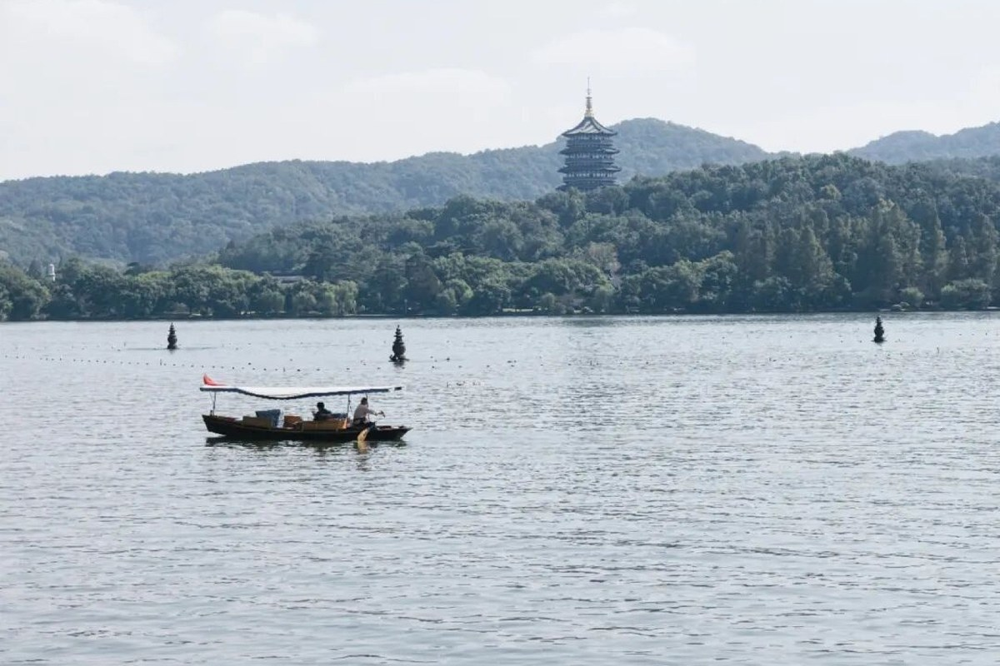

| 项目 | 内容 |
|---|---|
| **具体地点** | 浙江杭州市西湖区 |
| **景观类型** | 湖泊 · 文化景观 |
| **最佳时间** | 3—5月桃柳、6—7月荷花、秋季桂雨、冬季断桥残雪 |
| **交通推荐** | 杭州东站或杭州站到达后，地铁、公交、共享单车与步行可覆盖主要湖滨线路 |
| **旺季门票** | **免费 元** |
| **必要观光车** | —（无强制区间交通） |
| **基础合计** | **免费** |
| **可选项目** | 雷峰塔 40 元；三潭印月登岛含船 70 元；岳王庙 25 元 |
| **价格来源** | 杭州市政府收费公园名录 · 携程 |

- **核验备注：** 环湖公共景区免费开放；灵隐飞来峰自 2025 年 12 月 1 日起免费
- **避坑提示：** 节假日周边停车与道路限制较多，核心区更适合公共交通

### 14. 苏州古典园林

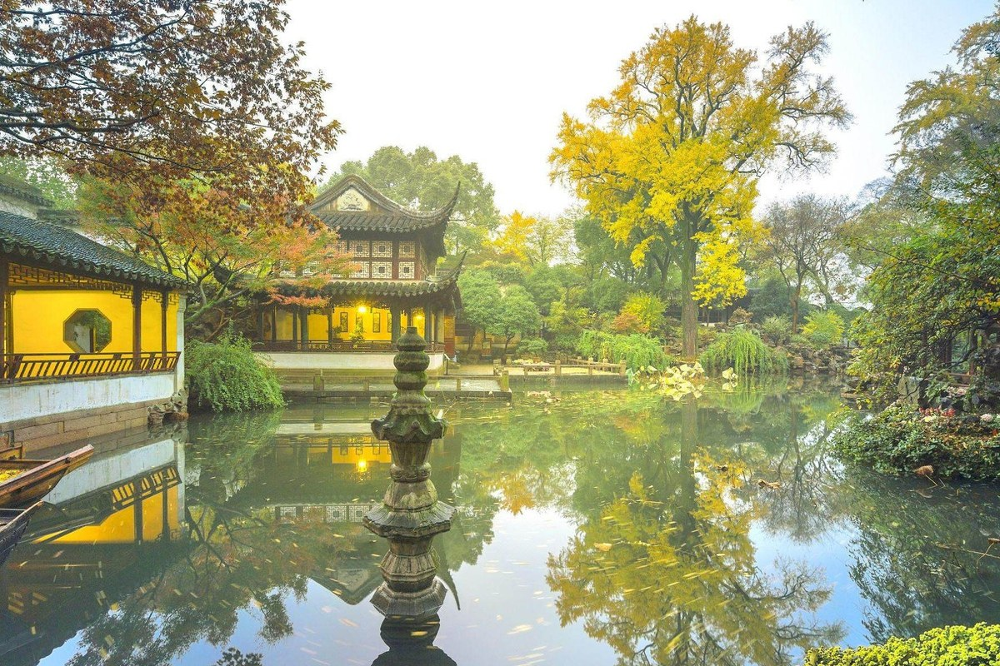

| 项目 | 内容 |
|---|---|
| **具体地点** | 江苏苏州市 |
| **景观类型** | 古典园林 |
| **最佳时间** | 3—5月、9—11月最适宜；夏季闷热、冬季人少 |
| **交通推荐** | 高铁至苏州站或苏州北站，地铁与公交连接拙政园、留园、网师园 |
| **旺季门票** | **80 元** |
| **必要观光车** | —（无强制区间交通） |
| **基础合计** | **¥80** |
| **可选项目** | 夜游拙政园 182—218 元；网师园夜花园 120 元；留园 55 元 |
| **价格来源** | 苏州市园林和绿化管理局 · 携程 |

- **核验备注：** 以拙政园旺季 80 元为基准（淡季 70 元）；留园旺季 55 元
- **避坑提示：** 园林之「精」在建筑、水景与植物层次，不宜一天机械打卡全部名录

### 15. 乌镇

| 项目 | 内容 |
|---|---|
| **具体地点** | 浙江嘉兴市桐乡市 |
| **景观类型** | 水乡古镇 |
| **最佳时间** | 3—5月、9—11月适合水乡漫步；冬季清冷，夏季多雨闷热 |
| **交通推荐** | 高铁至桐乡站转公交或出租；杭州、上海方向也可自驾 |
| **旺季门票** | **110 元** |
| **必要观光车** | —（无强制区间交通） |
| **基础合计** | **¥110** |
| **可选项目** | 西栅 150 元；东西栅联票 190 元；摇橹船拼船 60 元/程 |
| **价格来源** | 乌镇旅游官方商城 · 携程 |

- **核验备注：** 东栅 110 元，全年统一价无旺淡季；东西栅间接驳班车与公共摆渡船免费
- **避坑提示：** 节假日住宿价格上浮明显，预订前确认是否含门票与接驳

### 16. 婺源古村落群

| 项目 | 内容 |
|---|---|
| **具体地点** | 江西上饶市婺源县 |
| **景观类型** | 乡村古镇 |
| **最佳时间** | 3月中旬—4月上旬油菜花；11月晒秋；夏季乡村避暑 |
| **交通推荐** | 飞景德镇、黄山或上饶，再租车包车；高铁可至上饶站或婺源站 |
| **旺季门票** | **150 元** |
| **必要观光车** | 130 元 |
| **基础合计** | **¥280** |
| **可选项目** | 婺源 10 景点 5 日联票 180 元；篁岭门票＋往返索道 165 元 |
| **价格来源** | 婺源乡村文旅 · 携程 |

- **核验备注：** 江岭旺季 150 元；篁岭上山无步行道，往返索道旺季 130 元属必须
- **避坑提示：** 乡村道路分散，油菜花期停车位紧张

### 17. 三清山

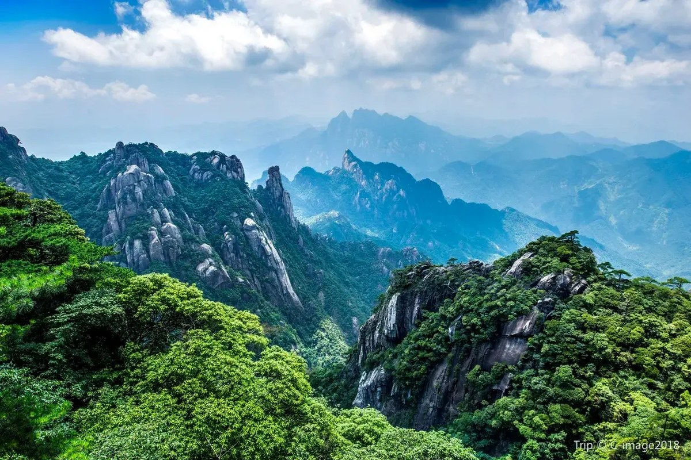

| 项目 | 内容 |
|---|---|
| **具体地点** | 江西上饶市玉山县 |
| **景观类型** | 花岗岩峰林 |
| **最佳时间** | 4—6月、9—11月；冬季可能形成雾凇但湿滑风险上升 |
| **交通推荐** | 飞上饶或景德镇，高铁至上饶站或玉山南站转景区交通 |
| **旺季门票** | **120 元** |
| **必要观光车** | 125 元 |
| **基础合计** | **¥245** |
| **可选项目** | 港首索道往返 150 元；单程上行 70 元、下行 55 元 |
| **价格来源** | 三清山景区公告 · 携程 |

- **核验备注：** 旺季门票 120 元；金沙/外双溪索道往返 125 元，常规游客基本必乘
- **避坑提示：** 索道不等于免台阶；高海拔栈道起雾时能见度低，应调整行程而非冒险穿越

### 18. 武夷山

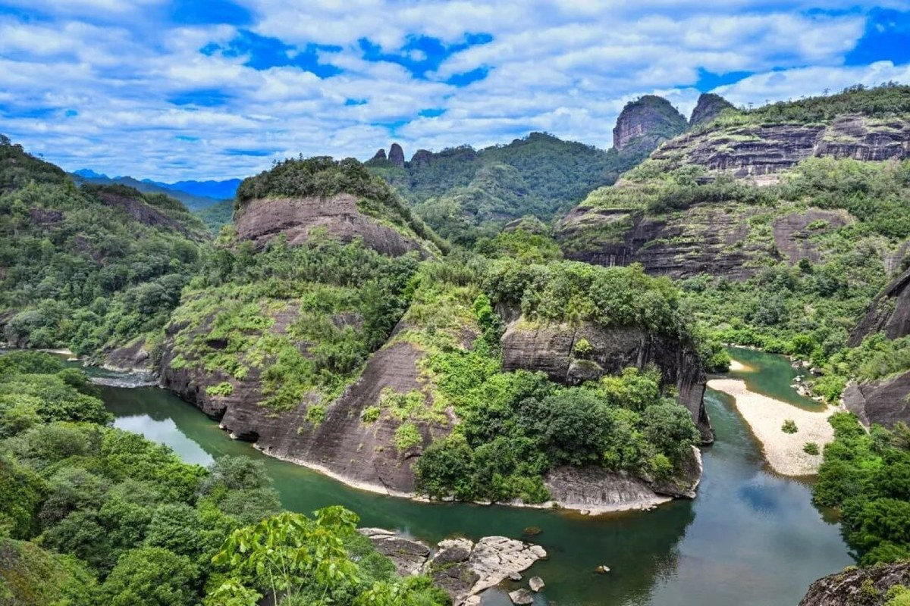

| 项目 | 内容 |
|---|---|
| **具体地点** | 福建南平市武夷山市 |
| **景观类型** | 丹霞 |
| **最佳时间** | 4—5月、9—11月；夏季适合漂流但湿热多雨 |
| **交通推荐** | 高铁直达武夷山北站或南平市站，景区接驳与九曲溪竹筏按官方时间安排 |
| **旺季门票** | **免门票 元** |
| **必要观光车** | 95 元 |
| **基础合计** | **¥95** |
| **可选项目** | 九曲溪竹筏约 130 元（须提前线上预约）；印象大红袍 208 元起 |
| **价格来源** | 南平市人民政府 · 福建省政府公报 |

- **核验备注：** 2026 年主景区继续执行免门票政策（原旺季 140 元）；观光车 3 日票 95 元，景点分散基本必乘
- **避坑提示：** 警惕茶旅高价推销；雨天九曲溪水位变化可能调整运营

### 19. 普陀山

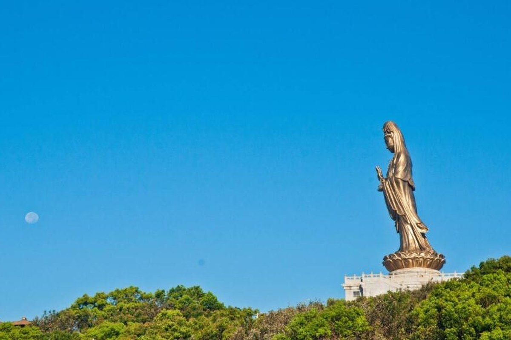

| 项目 | 内容 |
|---|---|
| **具体地点** | 浙江舟山市普陀区普陀山岛 |
| **景观类型** | 佛教名山 |
| **最佳时间** | 4—6月、9—11月；农历佛教节日客流集中 |
| **交通推荐** | 经杭州、宁波或舟山机场进入后需乘船；朱家尖至普陀山船班受天气与海况影响 |
| **旺季门票** | **160 元** |
| **必要观光车** | 60 元 |
| **基础合计** | **¥220** |
| **可选项目** | 三大寺香花券各 5 元；南海观音 6 元；佛顶山索道往返 70 元 |
| **价格来源** | 舟山市人民政府 · 普陀山一码通 |

- **核验备注：** 旺季（2—11月）进山门票 160 元，法定节假日 200 元；朱家尖往返船票 60 元属必须
- **避坑提示：** 尊重宗教礼仪，不穿过于暴露衣物，不在法会区域随意拍摄

### 20. 鼓浪屿

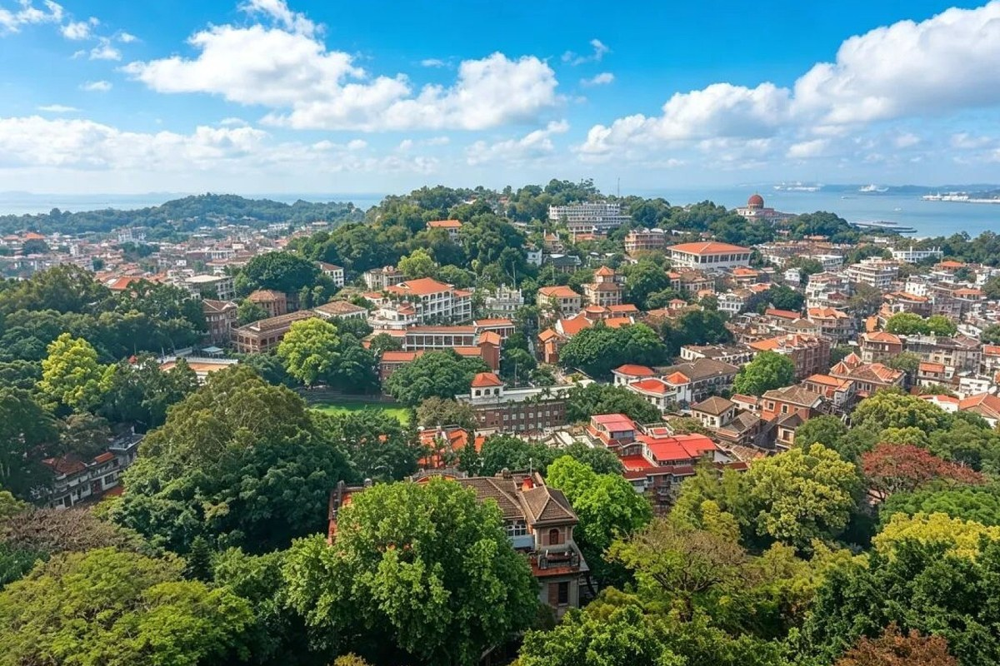

| 项目 | 内容 |
|---|---|
| **具体地点** | 福建厦门市思明区 |
| **景观类型** | 海岛 · 建筑 |
| **最佳时间** | 3—5月、10—11月最舒适；夏季炎热且需关注台风预警 |
| **交通推荐** | 高铁或飞机抵厦门后，从邮轮中心厦鼓码头乘船登岛 |
| **旺季门票** | **免费 元** |
| **必要观光车** | 70 元 |
| **基础合计** | **¥70** |
| **可选项目** | 日光岩 50 元；菽庄花园 30 元；五大景点联票 112—128 元 |
| **价格来源** | 屿见厦门轮渡 · 携程 |

- **核验备注：** 全岛无大门票；游客往返船票约 70 元（普通舱），离岛返程 20 天内有效
- **避坑提示：** 不要把全岛简化为单一「门票」；节假日船票与住宿须提前预订

---

## 五、华中 · 华南（21—30）

**以喀斯特峰林、峡谷、丹霞、溶洞和少数民族村落为主线，地貌对降雨与道路条件高度敏感。**

*交通建议：行程至少预留一天雨天替代方案，避免把户外活动全部压在固定日期；地貌游览与村寨文化宜拆开安排。*

### 21. 武陵源风景名胜区

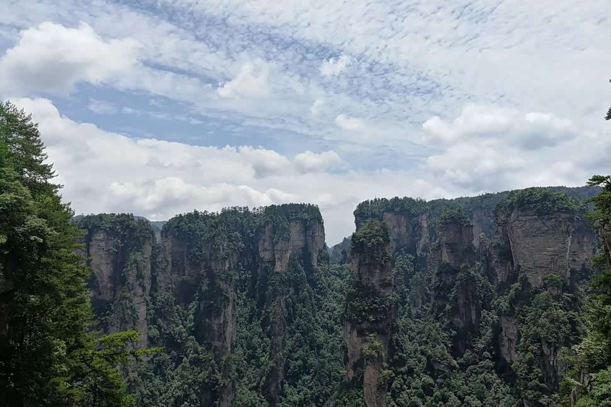

| 项目 | 内容 |
|---|---|
| **具体地点** | 湖南张家界市武陵源区 |
| **景观类型** | 砂岩峰林 |
| **最佳时间** | 4—6月、9—11月；夏季雨后云海机会较多但暴雨雷电影响索道 |
| **交通推荐** | 飞张家界荷花机场或高铁至张家界西站转景区专线 |
| **旺季门票** | **165 元** |
| **必要观光车** | 72 元 |
| **基础合计** | **¥237** |
| **可选项目** | 百龙天梯单程 65 元；天子山索道 72 元；杨家界索道 76 元 |
| **价格来源** | 张家界市政府 · 发改部门 |

- **核验备注：** 森林公园旺季门票 165 元（4 日有效）；核心景区环保车 72 元为政府指导价，基本必乘
- **避坑提示：** 不要把 OTA 组合价视为景区单一门票；雨天天门山玻璃栈道会调整，服从现场管理

### 22. 凤凰古城

| 项目 | 内容 |
|---|---|
| **具体地点** | 湖南湘西土家族苗族自治州凤凰县沱江镇 |
| **景观类型** | 古城古镇 |
| **最佳时间** | 3月下旬—5月、9月中旬—11月上旬；夏季多雨 |
| **交通推荐** | 飞铜仁凤凰机场或高铁至凤凰古城站转接驳；也可从张家界陆路前往 |
| **旺季门票** | **免费 元** |
| **必要观光车** | —（无强制区间交通） |
| **基础合计** | **免费** |
| **可选项目** | 沱江日游船 78 元；沱江日游＋古城联票 128 元；湘见沱江夜游 148 元 |
| **价格来源** | 携程 |

- **核验备注：** 古城街区免费开放，现行可靠来源未检索到有效的「古城维护费」；收费集中在九景联票与游船
- **避坑提示：** 夜间临水酒吧噪音明显，临江房未必适合追求安静者

### 23. 桂林—阳朔峰林

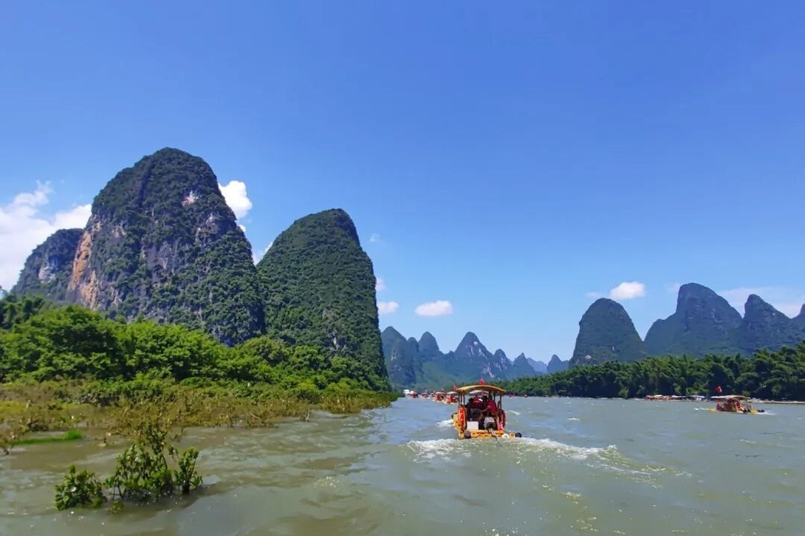

| 项目 | 内容 |
|---|---|
| **具体地点** | 广西桂林市阳朔县一带 |
| **景观类型** | 喀斯特峰林 |
| **最佳时间** | 4—6月、9—11月；雨季漓江水色变化大 |
| **交通推荐** | 飞桂林两江机场或高铁至桂林北、阳朔站；桂林市区、阳朔与西街分段住宿 |
| **旺季门票** | **免费 元** |
| **必要观光车** | —（无强制区间交通） |
| **基础合计** | **免费** |
| **可选项目** | 漓江三星游船 215 元起；四星约 360 元；遇龙河双人筏 400 元/筏（约 200 元/人）；相公山 60 元 |
| **价格来源** | 携程 |

- **核验备注：** 峰林与漓江沿岸公共观景区无统一大门票，花费集中在游船与竹筏项目
- **避坑提示：** 警惕非法排筏、低价摄影与强制消费；确认安全装备

### 24. 德天瀑布

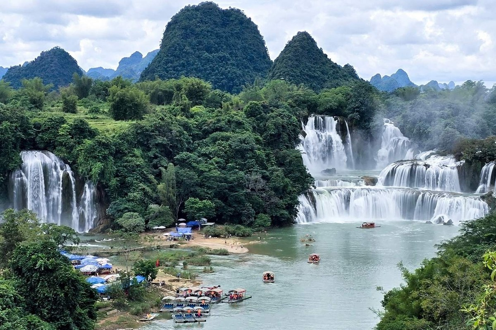

| 项目 | 内容 |
|---|---|
| **具体地点** | 广西崇左市大新县硕龙镇中越边境 |
| **景观类型** | 跨国瀑布 |
| **最佳时间** | 6—10月水量最丰；旱季景观明显收缩 |
| **交通推荐** | 飞南宁吴圩机场后租车、包车前往；也可从崇左方向进入 |
| **旺季门票** | **80 元** |
| **必要观光车** | 35 元 |
| **基础合计** | **¥115** |
| **可选项目** | 日场含门票＋往返观光车 115 元；夜场赠观光车 168 元 |
| **价格来源** | 崇左市政府 · 大新县政府 |

- **核验备注：** 首道门票 80 元；集散中心至核心景区往返观光车 35 元，日场票捆绑，游客基本必乘
- **避坑提示：** 边境区域不得越界、违规航拍；导游、车辆与游船选择正规渠道

### 25. 黄姚古镇

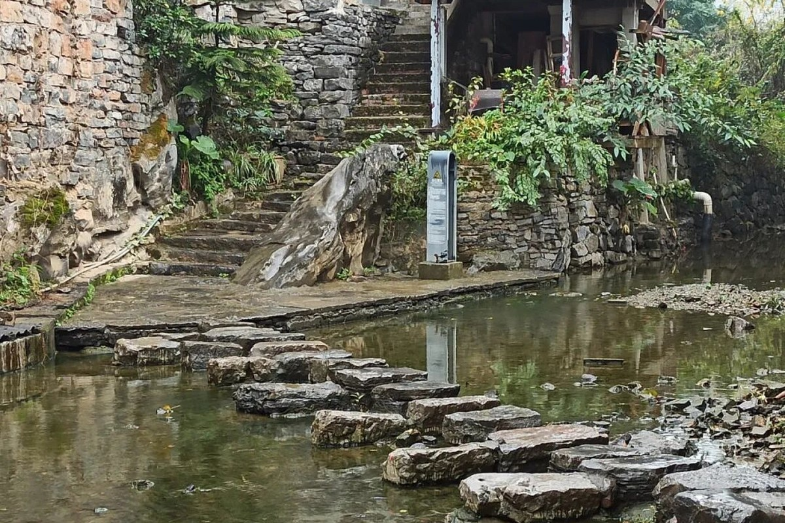

| 项目 | 内容 |
|---|---|
| **具体地点** | 广西贺州市昭平县黄姚镇 |
| **景观类型** | 古镇 |
| **最佳时间** | 3—5月、9—11月最适宜；雨后青石板与湖面倒影突出 |
| **交通推荐** | 飞桂林或梧州，高铁至贺州站转车；也可从阳朔方向自驾进入 |
| **旺季门票** | **88 元** |
| **必要观光车** | —（无强制区间交通） |
| **基础合计** | **¥88** |
| **可选项目** | 暑期特惠 66 元（7.10—9.30）；新能源车主优惠票 52 元 |
| **价格来源** | 贺州市文化广电和旅游局 |

- **核验备注：** 官方公告原价 88 元；平台常见 26 元为限时促销双人票折算，未采用
- **避坑提示：** 商业化程度低于热门夜游水乡；住宿应提前确认隔音与停车

### 26. 万峰林

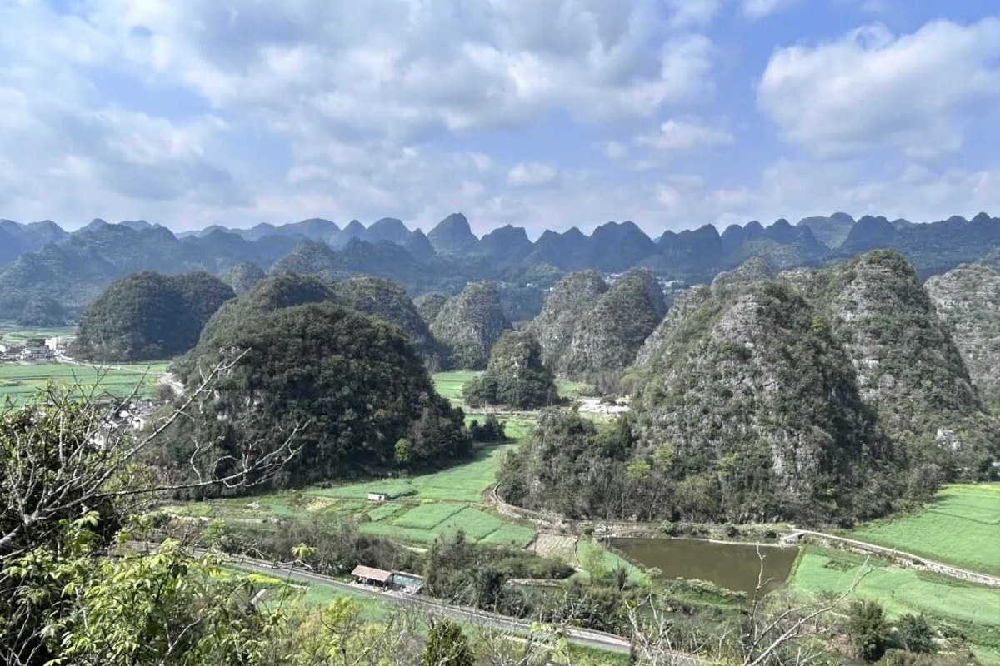

| 项目 | 内容 |
|---|---|
| **具体地点** | 贵州黔西南州兴义市 |
| **景观类型** | 喀斯特峰林 |
| **最佳时间** | 2月下旬—3月油菜花；4—6月、9—11月气候舒适 |
| **交通推荐** | 飞兴义万峰林机场或高铁至兴义北站，再租车、包车或乘景区交通 |
| **旺季门票** | **70 元** |
| **必要观光车** | 50 元 |
| **基础合计** | **¥120** |
| **可选项目** | 门票＋观光车套票 120 元 |
| **价格来源** | 贵州省人民政府 · 贵州省发改委 |

- **核验备注：** 旺季（3.1—11.30）门票 70 元；观峰道观光车 50 元，步行凌峰步道可免
- **避坑提示：** 喀斯特山区雨季可能发生落石与道路中断，需关注预警

### 27. 罗平峰林与九龙瀑布

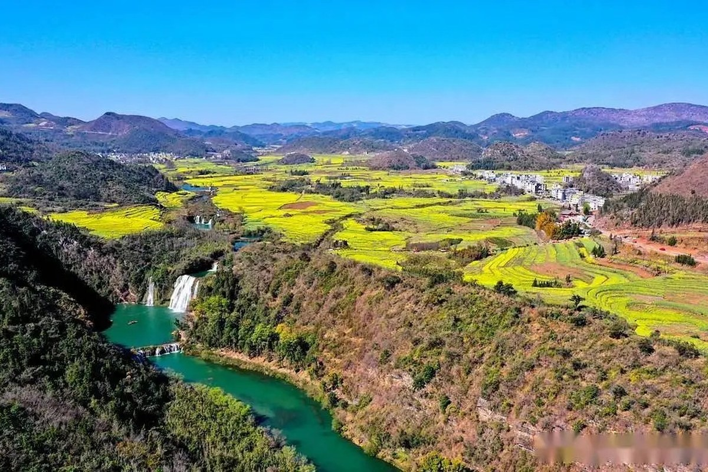

| 项目 | 内容 |
|---|---|
| **具体地点** | 云南曲靖市罗平县 |
| **景观类型** | 峰林 · 瀑布 |
| **最佳时间** | 2—3月油菜花海与峰林；4—6月瀑布水量较好 |
| **交通推荐** | 飞昆明或曲靖，高铁至曲靖北站转陆路；从兴义进入也较方便 |
| **旺季门票** | **65 元** |
| **必要观光车** | —（无强制区间交通） |
| **基础合计** | **¥65** |
| **可选项目** | 门票＋电动竹筏 78 元；门票＋飞毯＋滑道＋竹筏 128 元；那色峰海 30 元 |
| **价格来源** | 罗平官方攻略 · 携程 |

- **核验备注：** 九龙瀑布群旺季首道门票 65 元；平台 60 元为渠道限时价，未采用
- **避坑提示：** 花期道路拥堵，民宿与包车宜提前确认

### 28. 丹霞山

| 项目 | 内容 |
|---|---|
| **具体地点** | 广东韶关市仁化县 |
| **景观类型** | 丹霞 |
| **最佳时间** | 3月下旬—5月、9—11月最舒适；夏季炎热多雨 |
| **交通推荐** | 高铁至韶关站转公交或包车；广州、深圳自驾约 3—4 小时 |
| **旺季门票** | **100 元** |
| **必要观光车** | —（无强制区间交通） |
| **基础合计** | **¥100** |
| **可选项目** | 索道双程 110 元；水上丹霞游船 108 元；夜游船 158 元 |
| **价格来源** | 韶关市人民政府 · 丹霞山景区 |

- **核验备注：** 2026 年全票 100 元，48 小时内有效；景区为购票游客提供免费接驳车
- **避坑提示：** 阳元石、长老峰与翔龙湖开放安排不同；高温天备足饮水，雨天台阶湿滑

### 29. 海陵岛

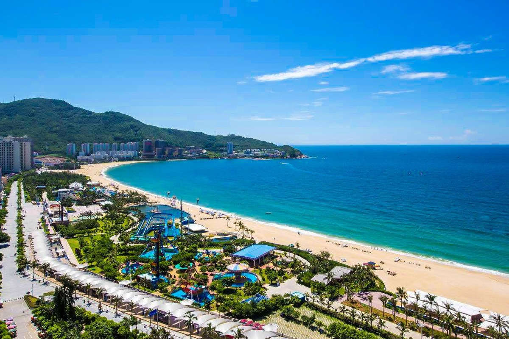

| 项目 | 内容 |
|---|---|
| **具体地点** | 广东阳江市江城区海陵岛 |
| **景观类型** | 海岸 |
| **最佳时间** | 5—10月适合海滨，7—8月最热闹，需关注台风预警 |
| **交通推荐** | 飞珠海、广州或湛江再租车前往；广州至阳江也可高铁接驳 |
| **旺季门票** | **49 元** |
| **必要观光车** | —（无强制区间交通） |
| **基础合计** | **¥49** |
| **可选项目** | 海上丝路博物馆 63 元；大角湾一票通 458 元 |
| **价格来源** | 阳江海陵岛试验区政务网站 |

- **核验备注：** 大角湾海上丝路旅游区旺季单次票 49 元；十里银滩公共海滩免费
- **避坑提示：** 大角湾、十里银滩收费模式不同；水上项目须查验资质，注意防晒与离岸流

### 30. 大嵛山岛

| 项目 | 内容 |
|---|---|
| **具体地点** | 福建宁德市福鼎市 |
| **景观类型** | 海岛 |
| **最佳时间** | 5—10月，7—9月适合海岛，需关注台风与船班 |
| **交通推荐** | 先到福鼎，再转至渔井、嵛山等码头乘船；班次以海事与码头公告为准 |
| **旺季门票** | **40 元** |
| **必要观光车** | 56 元 |
| **基础合计** | **¥96** |
| **可选项目** | 往返船票另有 115—120 元口径；岛上共享单车 20 元/小时起 |
| **价格来源** | 福鼎官方媒体 · 携程 |

- **核验备注：** 天湖景区门票 40 元；岛内往返观光车 36 元＋摆渡口径合计约 56 元，上岛必须乘船
- **避坑提示：** 海岛天气突变，风力、海浪与能见度均可能影响航行，应预留至少一天缓冲

---

## 六、西南高原（31—40）

**自然强度最高，真实成本不仅是门票，还包括远距离接驳、住宿海拔、限流与天气不确定性。**

*交通建议：从成都、昆明、丽江、香格里拉、林芝或拉萨分别组织；高原线路不宜为凑数连续增加景区，时间与缓冲优先于景点数量。*

### 31. 九寨沟

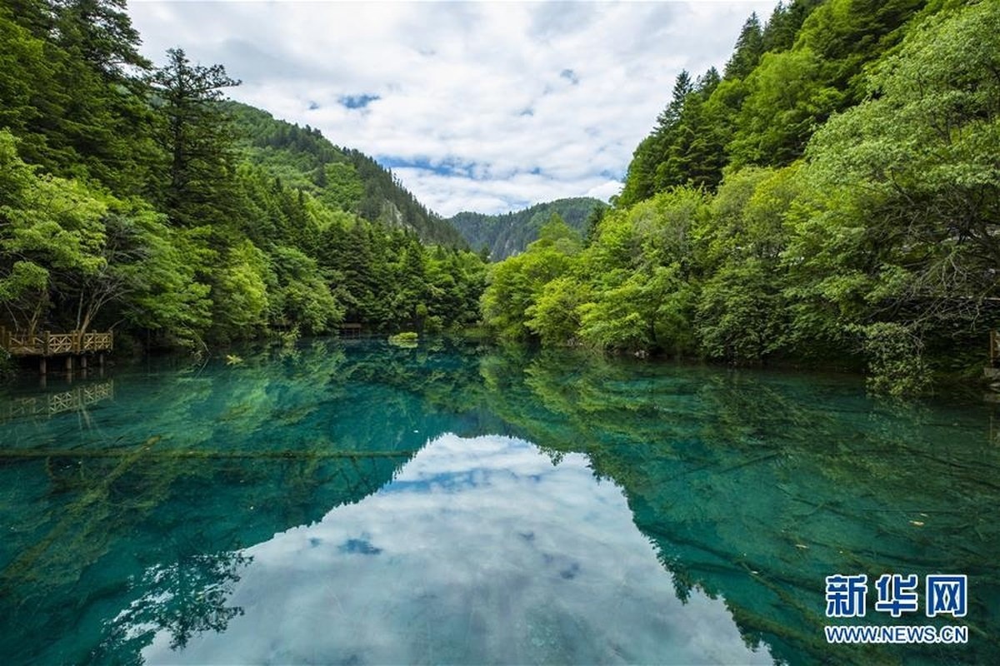

| 项目 | 内容 |
|---|---|
| **具体地点** | 四川阿坝藏族羌族自治州九寨沟县 |
| **景观类型** | 高原湖泊 |
| **最佳时间** | 9月下旬—10月下旬最著名；4—6月游客相对少 |
| **交通推荐** | 飞九寨黄龙机场或动车至黄龙九寨站、松潘站，转景区直通车或客运班车 |
| **旺季门票** | **190 元** |
| **必要观光车** | 90 元 |
| **基础合计** | **¥280** |
| **可选项目** | 保险 10 元（自愿） |
| **价格来源** | 九寨沟风景名胜区管理局 · 人民网四川 |

- **核验备注：** 旺季（4.1—11.15）门票 190 元＋观光车 90 元；沟内游、沟外住，社会车辆不能入园
- **避坑提示：** 景区内应沿栈道行走、避免剧烈运动；区间交通是核心成本而非可选项

### 32. 黄龙

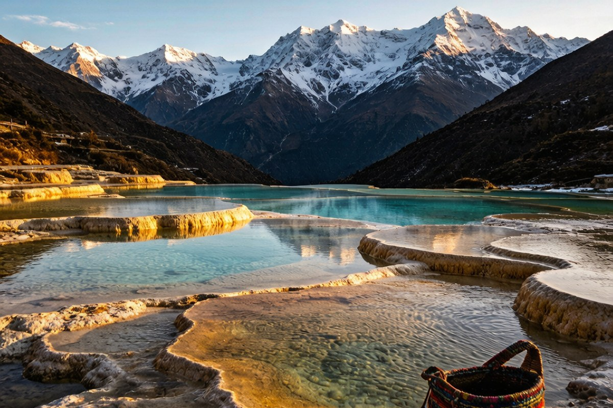

| 项目 | 内容 |
|---|---|
| **具体地点** | 四川阿坝藏族羌族自治州松潘县 |
| **景观类型** | 钙化彩池 |
| **最佳时间** | 9月下旬—10月彩池与彩林；夏季水量充沛 |
| **交通推荐** | 可从九寨沟方向或成都、川主寺方向进入 |
| **旺季门票** | **170 元** |
| **必要观光车** | —（无强制区间交通） |
| **基础合计** | **¥170** |
| **可选项目** | 红岩关索道上行 80 元、下行 40 元 |
| **价格来源** | 黄龙景区官方公众号 · 人民网四川 |

- **核验备注：** 旺季（6.1—12.15）门票 170 元；索道为可选项目，但高海拔游览强烈建议上行
- **避坑提示：** 高海拔游客建议使用索道并控制步行强度；心肺疾病或急性高反者不应硬撑

### 33. 稻城亚丁

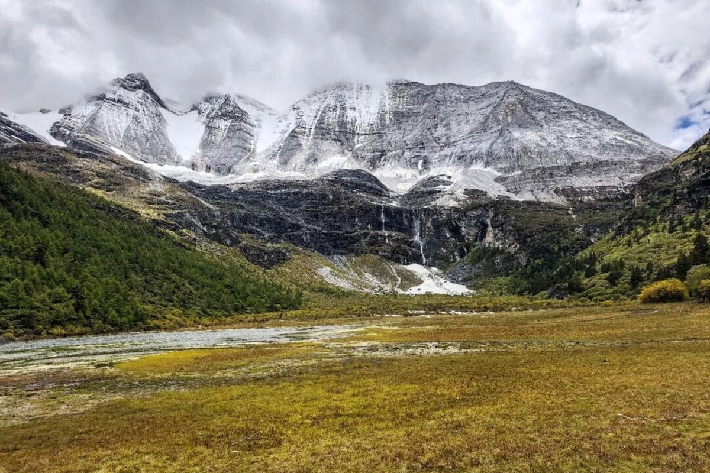

| 项目 | 内容 |
|---|---|
| **具体地点** | 四川甘孜藏族自治州稻城县香格里拉镇 |
| **景观类型** | 雪山 · 圣湖 |
| **最佳时间** | 5—6月、9月下旬—10月中旬；冬季部分道路可能受积雪影响 |
| **交通推荐** | 飞稻城亚丁机场，或经成都、康定、香格里拉方向陆路进入 |
| **旺季门票** | **146 元** |
| **必要观光车** | 120 元 |
| **基础合计** | **¥266** |
| **可选项目** | 冲古寺—洛绒牛场游览车 70 元（往返，自愿） |
| **价格来源** | 稻城亚丁景区公告 · 四川日报 |

- **核验备注：** 旺季（4.16—11.25）门票 146 元；游客中心至扎灌崩观光车 120 元，社会车辆不可进核心区
- **避坑提示：** 长线徒步对体力、高反、天气与装备要求很高，短线游客不应低估海拔

### 34. 贡嘎山与子梅垭口观景区

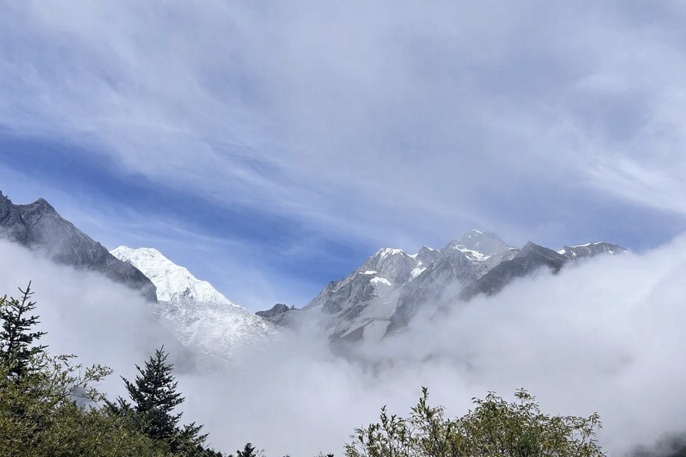

| 项目 | 内容 |
|---|---|
| **具体地点** | 四川甘孜州康定市、泸定县、九龙县一带 |
| **景观类型** | 极高山 |
| **最佳时间** | 10月—次年 4 月云量少；5—6月相对温和 |
| **交通推荐** | 康定、泸定与磨西为主要中转方向，车辆要求随季节与道路变化 |
| **旺季门票** | **90 元** |
| **必要观光车** | 70 元 |
| **基础合计** | **¥160** |
| **可选项目** | 海螺沟客运索道往返 135 元 |
| **价格来源** | 海螺沟景区管委会 · 四川广播电视台 |

- **核验备注：** 以海螺沟景区为代表收费点；子梅垭口、冷嘎措等观景点无统一门票，准入与防火管控须现场确认
- **避坑提示：** 垭口只是观景点，不等同于登顶；尊重当地信仰，不擅入封控牧场

### 35. 四姑娘山

| 项目 | 内容 |
|---|---|
| **具体地点** | 四川阿坝藏族羌族自治州小金县日隆镇 |
| **景观类型** | 极高山 |
| **最佳时间** | 5—6月、9月下旬—10月适合观光与登山；冬季为专业冰雪活动 |
| **交通推荐** | 从成都经巴朗山或卧龙方向进入，车辆须符合道路与季节要求 |
| **旺季门票** | **80 元** |
| **必要观光车** | 70 元 |
| **基础合计** | **¥150** |
| **可选项目** | 长坪沟门票 70 元＋观光车 20 元；海子沟门票 60 元 |
| **价格来源** | 阿坝旅游网 · 四姑娘山景区管理局 |

- **核验备注：** 以双桥沟为例：旺季门票 80 元＋观光车 70 元；三条沟分别售票，不是联票
- **避坑提示：** 未经许可不得开展高海拔登山

### 36. 雅鲁藏布大峡谷

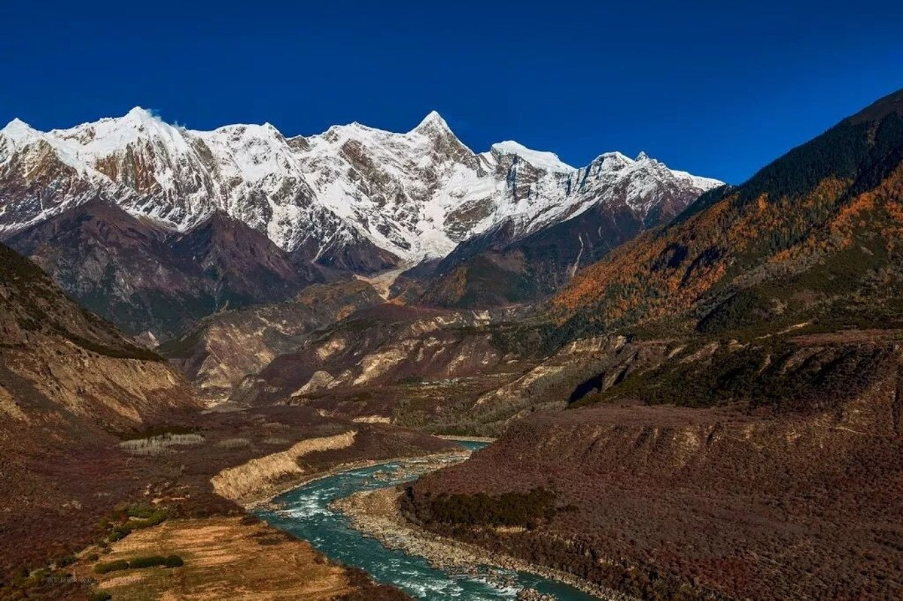

| 项目 | 内容 |
|---|---|
| **具体地点** | 西藏林芝市米林市派镇一带 |
| **景观类型** | 峡谷 |
| **最佳时间** | 3月下旬—5月桃花与雪山；9月下旬—11月峡谷秋色 |
| **交通推荐** | 林芝米林机场或拉萨方向进入，峡谷内部依赖观光车 |
| **旺季门票** | **150 元** |
| **必要观光车** | 90 元 |
| **基础合计** | **¥240** |
| **可选项目** | 热气球约 199 元；游船＋下午茶 255 元 |
| **价格来源** | 西藏米林文旅官方公众号 · 携程 |

- **核验备注：** 南北两岸通票 150 元；游览线路近 40 公里，观光车 90 元强烈建议购买（平台联票 240 元）
- **避坑提示：** 南迦巴瓦并非每次都能看到，索松村与直白村也并非唯一机位

### 37. 林芝桃花与波密岗乡云杉林

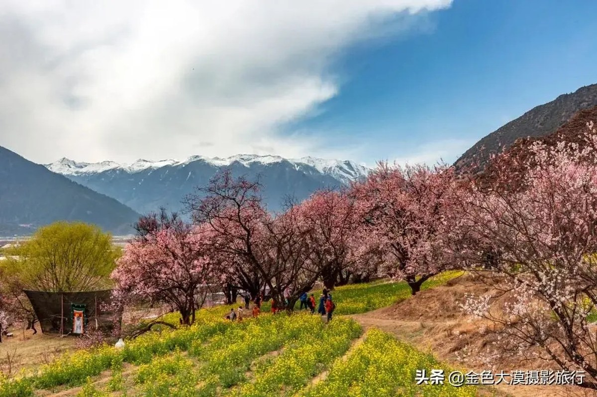

| 项目 | 内容 |
|---|---|
| **具体地点** | 西藏林芝市巴宜区、波密县 |
| **景观类型** | 森林 · 花季 |
| **最佳时间** | 桃花季集中在 3月中旬—4月上旬，随海拔与气温变化 |
| **交通推荐** | 飞林芝米林机场，或经川藏、滇藏公路进入 |
| **旺季门票** | **30 元** |
| **必要观光车** | —（无强制区间交通） |
| **基础合计** | **¥30** |
| **可选项目** | 岗云杉林 80 元；部分围合观景点收 5—10 元维护费 |
| **价格来源** | 西藏权威媒体 · 渠道攻略 |

- **核验备注：** 以嘎拉桃花村 30 元为代表；岗云杉林 80 元。两者非同一景区，波密桃花谷整体免费
- **避坑提示：** 桃花节期间住宿紧张，预订须确认取消规则；波密至然乌方向不宜夜间赶路

### 38. 南迦巴瓦峰

| 项目 | 内容 |
|---|---|
| **具体地点** | 西藏林芝市米林市、波密县交界 |
| **景观类型** | 极高山 |
| **最佳时间** | 秋季云量相对较低，但全年可见率都不稳定 |
| **交通推荐** | 从林芝或雅鲁藏布大峡谷方向前往索松村、色季拉山口等观景点 |
| **旺季门票** | **150 元** |
| **必要观光车** | 90 元 |
| **基础合计** | **¥240** |
| **可选项目** | 峡谷热气球、游船等体验项目 |
| **价格来源** | 西藏米林文旅官方公众号 · 携程 |

- **核验备注：** 山峰本身无独立门票；索松村位于雅鲁藏布大峡谷景区游览范围，收费载体为该景区门票；色季拉山口为国道公共观景点，免费
- **避坑提示：** 不要把「十人九不遇」写成必然能拍到的日落奇观；高原驾驶与夜间能见度需纳入计划

### 39. 喀拉峻与那拉提草原

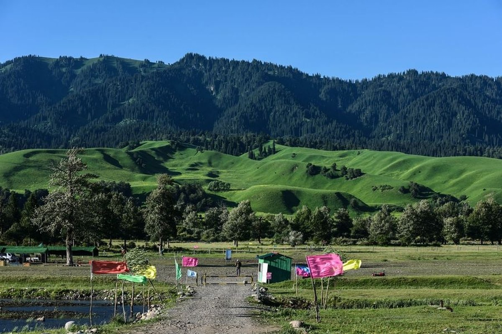

| 项目 | 内容 |
|---|---|
| **具体地点** | 新疆伊犁州特克斯县、新源县 |
| **景观类型** | 草原 |
| **最佳时间** | 6月中旬—7月草原花海最好；9月秋色 |
| **交通推荐** | 从伊宁方向租车或包车进入，夏季旺季须预约 |
| **旺季门票** | **95 元** |
| **必要观光车** | 180 元 |
| **基础合计** | **¥275** |
| **可选项目** | 那拉提门票 95 元＋区间车 120 元；那拉提索道单程 68 元 |
| **价格来源** | 新疆维吾尔自治区发改委 · 那拉提景区 |

- **核验备注：** 喀拉峻全域票 95 元/2 天＋全域区间车通票 180 元；那拉提 95 元＋120 元。两者为不同景区，不可合并计算
- **避坑提示：** 草原昼夜温差大；禁火、禁牧区与生态保护红线须遵守

### 40. 巴音布鲁克与九曲十八弯

| 项目 | 内容 |
|---|---|
| **具体地点** | 新疆巴音郭楞蒙古自治州和静县 |
| **景观类型** | 草原 · 湿地 |
| **最佳时间** | 6—9月最适宜；9月适合日落与候鸟 |
| **交通推荐** | 可从伊宁、库车或和静方向进入，夏季草原道路较长 |
| **旺季门票** | **65 元** |
| **必要观光车** | 62 元 |
| **基础合计** | **¥127** |
| **可选项目** | 九曲十八弯观景台短途观光车单程 9 元、往返 18 元（现场单独售） |
| **价格来源** | 巴音布鲁克景区官方申明（2026.6） |

- **核验备注：** 官方公示统一票价：门票 65 元＋区间车 62 元＝套票 127 元，自驾套票同价，无隐形加价
- **避坑提示：** 观景台以落日余晖与河道曲线为主，拍摄不能越过栈道；高寒草原夜间低温

---

## 七、西北（41—50）

**景观尺度巨大、城市间距离长、预约要求强，适合以 7—12 天为单位的长途旅行，而非城市周末游。**

*交通建议：以西宁、兰州、敦煌、乌鲁木齐、阿勒泰、伊宁为枢纽；航班、铁路、包车与景区区间车须按完整环线安排。*

### 41. 青海湖

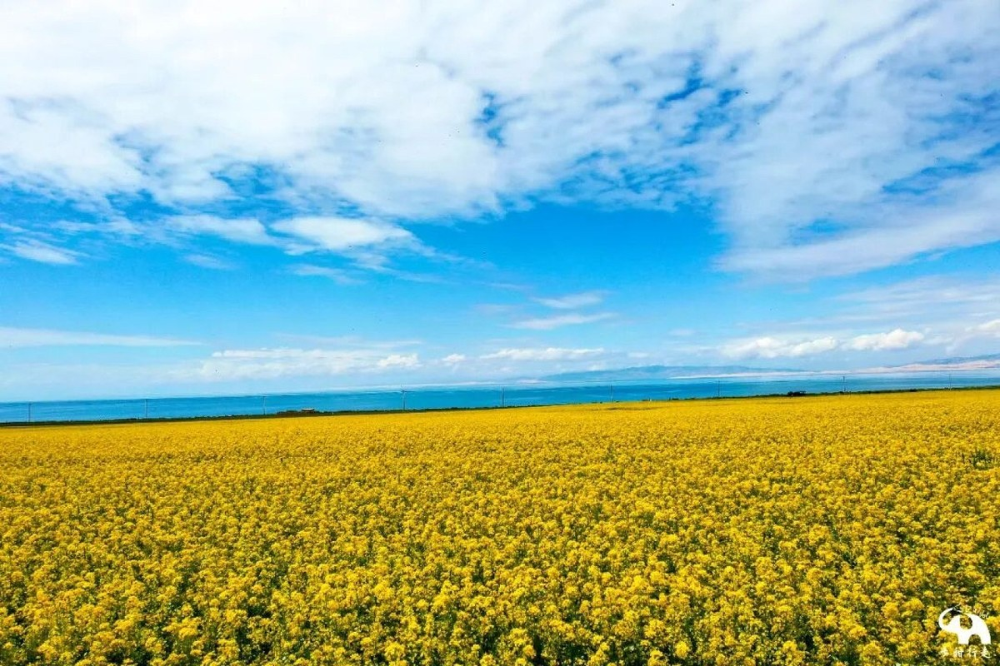

| 项目 | 内容 |
|---|---|
| **具体地点** | 青海海南州共和县、海北州刚察县与海晏县环湖区域 |
| **景观类型** | 高原湖泊 |
| **最佳时间** | 7月环湖与门源花海；5—9月总体适宜 |
| **交通推荐** | 飞西宁后租车或包车环湖；西海镇、黑马河与二郎剑适合不同玩法 |
| **旺季门票** | **190 元** |
| **必要观光车** | —（无强制区间交通） |
| **基础合计** | **¥190** |
| **可选项目** | 快艇 95 元；皇家马车 40 元 |
| **价格来源** | 携程 |

- **核验备注：** 二郎剑景区在售为「车登岛套票」190 元（含门票＋观光车），未单独售卖大门票，故按套票计
- **避坑提示：** 湖边草场与牧民私有土地不得擅入

### 42. 祁连山草原

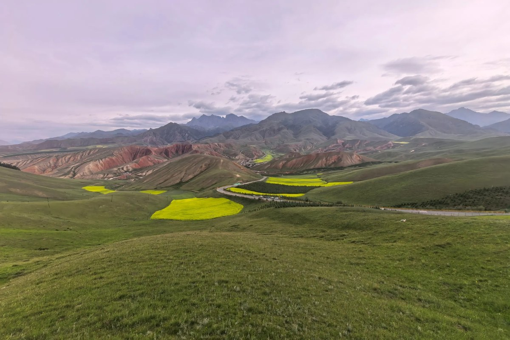

| 项目 | 内容 |
|---|---|
| **具体地点** | 青海海北州祁连县、甘肃张掖市肃南县一带 |
| **景观类型** | 草原 |
| **最佳时间** | 7月最适宜；9月下旬适合秋色 |
| **交通推荐** | 可从西宁、张掖或嘉峪关方向进入，适合与青海湖、张掖丹霞串联 |
| **旺季门票** | **60 元** |
| **必要观光车** | 20 元 |
| **基础合计** | **¥80** |
| **可选项目** | 景区栈道游览免费 |
| **价格来源** | 祁连县文体旅游广电局 |

- **核验备注：** 以卓尔山景区为代表：门票 60 元＋观光车 20 元，观景台之间仅车行道
- **避坑提示：** 高海拔道路需防范降雪与落石，草原昼夜温差大

### 43. 张掖丹霞

| 项目 | 内容 |
|---|---|
| **具体地点** | 甘肃张掖市临泽县、肃南裕固族自治县交界 |
| **景观类型** | 丹霞 |
| **最佳时间** | 6—9月适宜；日出日落时段更适合摄影，午间高温 |
| **交通推荐** | 飞张掖甘州机场或高铁至张掖西站转景区专线 |
| **旺季门票** | **54 元** |
| **必要观光车** | 20 元 |
| **基础合计** | **¥74** |
| **可选项目** | 深度游 368 元；舒享游 168—188 元；热气球另计 |
| **价格来源** | 澎湃新闻转景区官方票务说明 |

- **核验备注：** 七彩丹霞常规游总票 74 元＝门票 54 元＋观光车 20 元；四个观景台之间只有车行道
- **避坑提示：** 彩色丘陵与冰沟丹霞的票务及接驳规则可能不同，应分别核验；防风沙与强紫外线

### 44. 嘉峪关关城

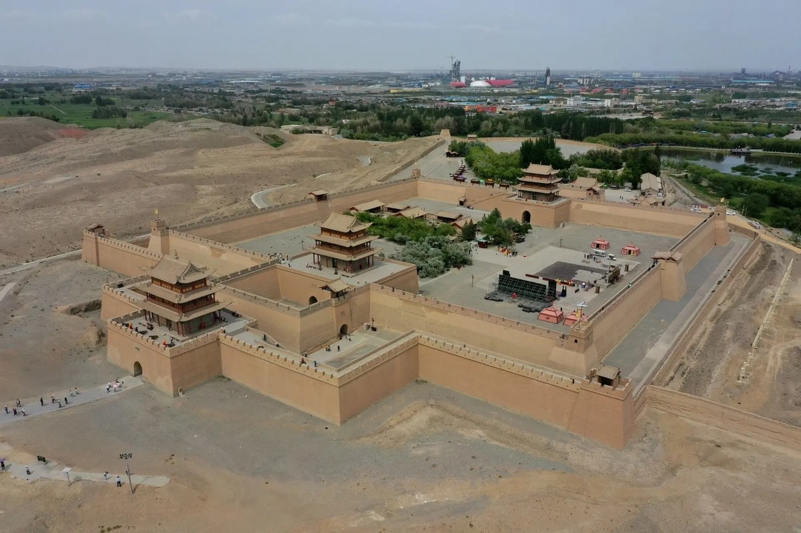

| 项目 | 内容 |
|---|---|
| **具体地点** | 甘肃嘉峪关市 |
| **景观类型** | 长城 · 关隘 |
| **最佳时间** | 5—10月最适宜；冬季可感受戈壁雪景但寒冷 |
| **交通推荐** | 高铁至嘉峪关南站，嘉峪关机场也可直飞部分城市 |
| **旺季门票** | **110 元** |
| **必要观光车** | 16 元 |
| **基础合计** | **¥126** |
| **可选项目** | 单程电瓶车 10 元；悬壁长城、长城第一墩各 21 元（2026 年购关城票赠券） |
| **价格来源** | 甘肃政务服务网 · 携程 |

- **核验备注：** 关城旺季 110 元（2026.5.1 起）；往返观光电瓶车 16 元；购关城票赠两景区当日参观券
- **避坑提示：** 戈壁紫外线强，自驾补水要充分

### 45. 鸣沙山—月牙泉

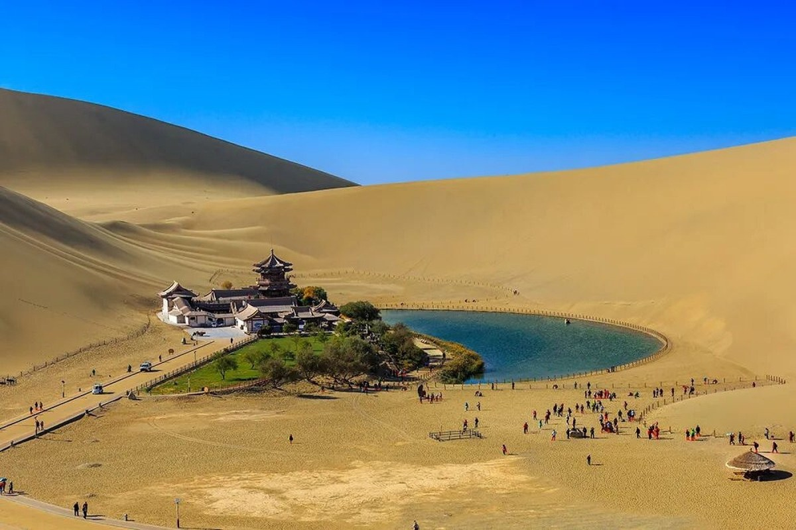

| 项目 | 内容 |
|---|---|
| **具体地点** | 甘肃敦煌市 |
| **景观类型** | 沙漠 |
| **最佳时间** | 5—6月、9—10月较舒适；7—8月炎热，冬季寒冷多风沙 |
| **交通推荐** | 飞敦煌莫高国际机场或高铁至敦煌站 |
| **旺季门票** | **110 元** |
| **必要观光车** | —（无强制区间交通） |
| **基础合计** | **¥110** |
| **可选项目** | 骑骆驼、滑沙、越野、热气球、露营等现场另计 |
| **价格来源** | 携程 · 同程 |

- **核验备注：** 旺季门票 110 元，三日有效可多次入园；园内无必须乘坐的区间车
- **避坑提示：** 与莫高窟同城，宜分别安排一天；夏季注意补水与防晒

### 46. 莫高窟

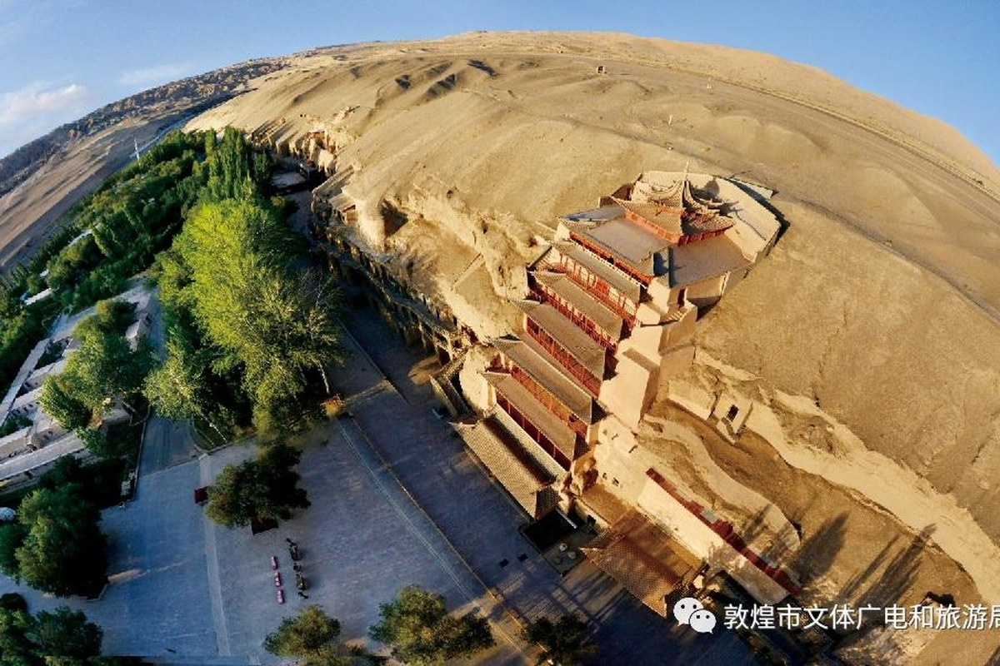

| 项目 | 内容 |
|---|---|
| **具体地点** | 甘肃敦煌市 |
| **景观类型** | 石窟寺 |
| **最佳时间** | 3月下旬—5月、9—11月较舒适；夏季炎热 |
| **交通推荐** | 必须按分时预约模式，通过敦煌研究院官方渠道购票 |
| **旺季门票** | **238 元** |
| **必要观光车** | —（无强制区间交通） |
| **基础合计** | **¥238** |
| **可选项目** | 应急参观 100 元（4 个洞窟）；特窟另收费 |
| **价格来源** | 莫高窟参观预约网官方公众号 |

- **核验备注：** 旺季常规参观 238 元，含数字电影、往返摆渡车与 8 个实体洞窟；讲解不另收费
- **避坑提示：** 不要购买来源不明的「代约票」；窟内禁用闪光灯、勿触摸壁画

### 47. 天山天池

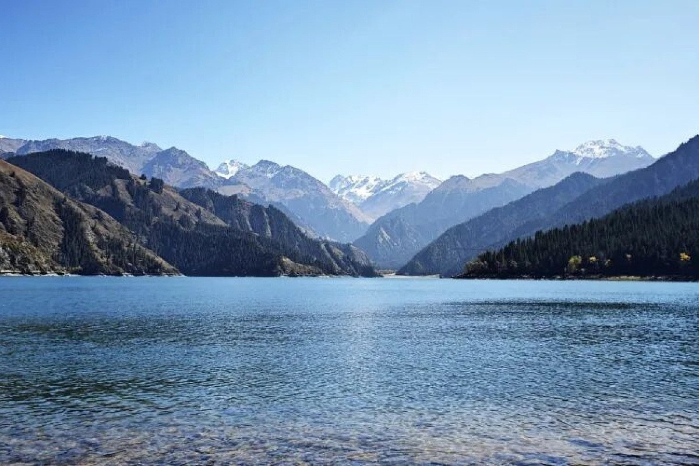

| 项目 | 内容 |
|---|---|
| **具体地点** | 新疆昌吉回族自治州阜康市 |
| **景观类型** | 高山湖泊 |
| **最佳时间** | 6—9月最适宜；冬季适合冰雪景观 |
| **交通推荐** | 飞乌鲁木齐后包车或乘景区交通前往 |
| **旺季门票** | **95 元** |
| **必要观光车** | 60 元 |
| **基础合计** | **¥155** |
| **可选项目** | 游船 100 元；马牙山观光车、索道组合另计 |
| **价格来源** | 同程 |

- **核验备注：** 成人套票 155 元＝门票 95 元＋往返区间车 60 元；官方票价文件未取得，按平台在售拆分
- **避坑提示：** 山区天气变化快，不应把天池四季呈现写成全年完全一致

### 48. 喀纳斯

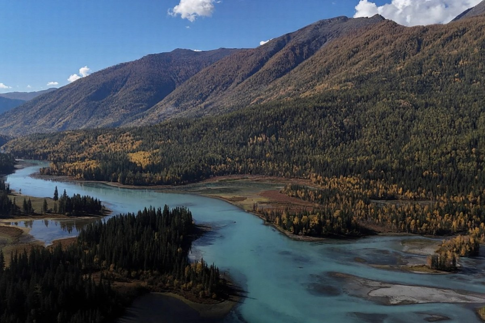

| 项目 | 内容 |
|---|---|
| **具体地点** | 新疆阿勒泰地区布尔津县禾木哈纳斯蒙古民族乡 |
| **景观类型** | 高山湖泊 |
| **最佳时间** | 9月中旬—10月上旬最著名；6—8月避暑，冬季冰雪线路 |
| **交通推荐** | 飞喀纳斯机场、布尔津或阿勒泰，再按道路与季节转景区交通 |
| **旺季门票** | **160 元** |
| **必要观光车** | 70 元 |
| **基础合计** | **¥230** |
| **可选项目** | 二日二进票 270 元；喀纳斯湖游船 120 元 |
| **价格来源** | 喀纳斯景区官方公众号 |

- **核验备注：** 夏季门票 160 元；一进往返区间车 70 元（48 小时内有效），二进 110 元
- **避坑提示：** 喀纳斯、禾木与白哈巴并非同一票务与边境管理区域，白哈巴边防要求须提前确认

### 49. 禾木村

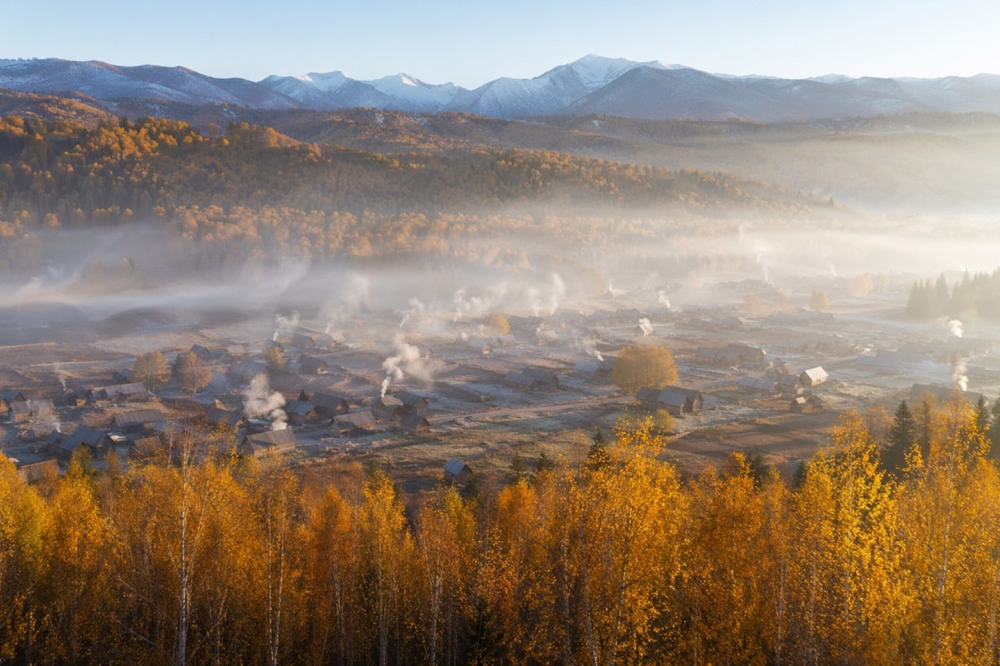

| 项目 | 内容 |
|---|---|
| **具体地点** | 新疆阿勒泰地区布尔津县禾木哈纳斯蒙古民族乡 |
| **景观类型** | 村落 |
| **最佳时间** | 9月中旬—10月上旬秋色；12月—次年 2 月雪村与冰雪项目 |
| **交通推荐** | 可从布尔津、贾登峪或喀纳斯方向进入，冬季道路与车辆要求更严格 |
| **旺季门票** | **50 元** |
| **必要观光车** | 25 元 |
| **基础合计** | **¥75** |
| **可选项目** | 观景台骑马、村内交通现场询价 |
| **价格来源** | 喀纳斯景区官方公众号 |

- **核验备注：** 禾木景区夏季门票 50 元＋区间车 25 元，官方为一票一车模式
- **避坑提示：** 观景平台与村庄的开放、门票与区间交通应分别核验；晨雾机位并非私人收费拍摄位

### 50. 轮台胡杨林

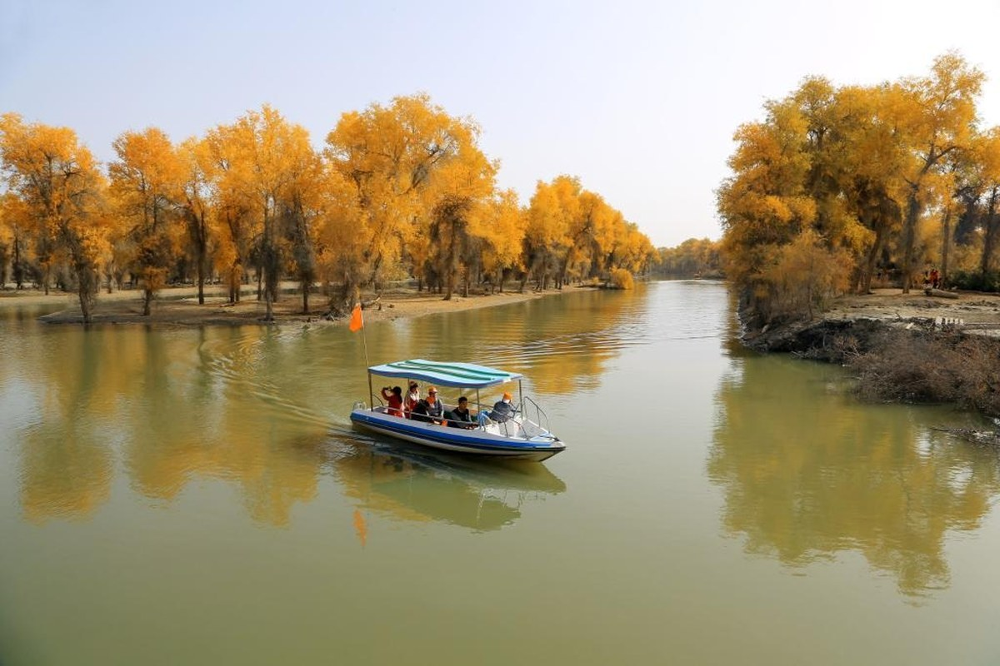

| 项目 | 内容 |
|---|---|
| **具体地点** | 新疆巴音郭楞蒙古自治州轮台县塔里木河流域 |
| **景观类型** | 沙漠森林 |
| **最佳时间** | 10月中旬—11月上旬，季节窗口短，受气温与水情影响 |
| **交通推荐** | 从库尔勒或轮台方向进入，沙漠公路与胡杨林道路应备足油料 |
| **旺季门票** | **40 元** |
| **必要观光车** | 25 元 |
| **基础合计** | **¥65** |
| **可选项目** | 观光小火车 100 元；7 座以下自驾票 80 元/车（仍须另购门票） |
| **价格来源** | 携程 |

- **核验备注：** 塔里木胡杨林公园旺季门票 40 元＋区间车 25 元；平台双人自驾票 140 元存在口径歧义，未采用
- **避坑提示：** 飞絮、沙尘与干燥需重点防护

---

## 八、基础成本 TOP 20

只算「门票＋必要观光车」的进园硬成本，不含索道、游船与演出。

| 排名 | 景点 | 基础合计 | 成本条 |
|---|---|---|---|
| 1 | 婺源古村落群 | **¥280** | `████████████████████` |
| 2 | 九寨沟 | **¥280** | `████████████████████` |
| 3 | 喀拉峻与那拉提草原 | **¥275** | `████████████████████` |
| 4 | 稻城亚丁 | **¥266** | `███████████████████` |
| 5 | 三清山 | **¥245** | `██████████████████` |
| 6 | 雅鲁藏布大峡谷 | **¥240** | `█████████████████` |
| 7 | 南迦巴瓦峰 | **¥240** | `█████████████████` |
| 8 | 莫高窟 | **¥238** | `█████████████████` |
| 9 | 武陵源风景名胜区 | **¥237** | `█████████████████` |
| 10 | 喀纳斯 | **¥230** | `████████████████` |
| 11 | 黄山 | **¥228** | `████████████████` |
| 12 | 长白山天池 | **¥225** | `████████████████` |
| 13 | 普陀山 | **¥220** | `████████████████` |
| 14 | 承德避暑山庄及周围寺庙 | **¥200** | `██████████████` |
| 15 | 千岛湖 | **¥195** | `██████████████` |
| 16 | 青海湖 | **¥190** | `██████████████` |
| 17 | 黄龙 | **¥170** | `████████████` |
| 18 | 贡嘎山与子梅垭口观景区 | **¥160** | `███████████` |
| 19 | 泰山 | **¥155** | `███████████` |
| 20 | 天山天池 | **¥155** | `███████████` |

## 九、怎么买才不吃亏

| 费用项目 | 需要确认的关键信息 | 常见误区 |
|---|---|---|
| **景区大门票** | 旺季、淡季、平旺季及优惠对象；是否含保险 | 把某一季节票价当成全年统一价 |
| **必要区间交通** | 是否必须乘坐、单程或往返、是否含在门票内 | 把可选索道、游船与强制接驳混为一谈 |
| **索道、电梯与游船** | 是否单程、运营时间与天气限制 | 只买上行票，忽略返程或封线风险 |
| **演出与讲解** | 是否强制、退改规则与包含区域 | 把第三方讲解或高价组合票视为官方必需项目 |
| **住宿** | 是否含接送、停车及景区门票 | 只看房费，不算景区外围住宿的接驳成本 |
| **包车与跨城交通** | 是否含高速费、停车费、司机餐宿 | 把「车费」误认为全部地面成本 |

**限流与预约：** 莫高窟、布达拉宫、九寨沟、稻城亚丁等实行实名分时预约与限流，能否入园本身就是行程变量，不要在抵达当天临时抢票。莫高窟、巴音布鲁克等景区已公开声明未授权第三方代抢票、代约票，只走官方小程序与合作平台。

**合规优先于出片：** 青藏高原、新疆边境、横断山区与内蒙古边境地区存在海拔、道路、通信与行政管理要求，须提前办理边防手续，遵守军事管理区、自然保护区与牧区规定。无人机须先查询禁飞区与当地空域要求。

---

## 十、季节速查：先选季节，再选区域

| 时段 | 推荐目的地 | 说明 |
|---|---|---|
| **2—3 月** | 罗平峰林与九龙瀑布、万峰林 | 油菜花海 + 喀斯特峰林，一年中最早的色彩高峰 |
| **3—4 月** | 林芝桃花、婺源、黄山早春 | 桃雪山同框与徽派油菜花，需提前订房 |
| **4—6 月** | 黄山、三清山、武夷山、张家界、桂林 | 气温舒适、云海概率高，名山主季 |
| **5—9 月** | 青海湖、祁连山、张掖丹霞 | 高原湖泊与草原尺度的最佳窗口 |
| **6—8 月** | 呼伦贝尔、大兴安岭、喀拉峻与那拉提 | 草原与森林最盛，暑期人流集中 |
| **7—8 月** | 海陵岛、大嵛山岛、天山天池 | 海滨与高山避暑，须关注台风与雷雨 |
| **9—10 月** | 九寨沟、黄龙、喀纳斯、禾木、盘锦红海滩 | 秋色峰值，也是最紧张的预约窗口 |
| **10—11 月** | 轮台胡杨林、稻城亚丁、黄山秋色、婺源晒秋 | 金色窗口，短且受气温与水情影响 |
| **12—2 月** | 长白山、禾木雪村、海陵岛、华南暖区 | 冰雪或避寒两极，装备与路况要求高 |

> 最合理的推进逻辑是先定季节、再定区域、最后选景点，而不是按清单顺序机械推进。任何行程都应保留至少一个无景点日。

---

## 十一、四种行程范式：跨 3—4 次旅行完成

### 华东轻旅行（8—12 天）

- **交通形态：** 高铁连接城市、名山与古镇
- **参考节奏：** 杭州 2 日—黄山 2 日—婺源 2 日—武夷山 2 日，苏州与乌镇作起讫段
- **适合：** 首次旅行、家庭出行、假期有限者

### 西北环线（10—14 天）

- **交通形态：** 飞机 + 包车为主
- **参考节奏：** 敦煌 3 天起，莫高窟、鸣沙山与市区各一天；青甘环线 4—6 天
- **适合：** 能适应长途车程、愿意提前预约者

### 西南高原（8—14 天）

- **交通形态：** 机场中转 + 景区交通 + 分段住宿
- **参考节奏：** 成都—九寨沟—黄龙至少 5 日；稻城亚丁 4—5 日含适应日
- **适合：** 有高原经验、能接受天气不确定性者

### 华南喀斯特（8—10 天）

- **交通形态：** 高铁 + 包车
- **参考节奏：** 张家界 2 天、阳朔 2 天、兴义与罗平串联 4—5 天
- **适合：** 关注峰林、丹霞与慢节奏旅居者

---

## 十二、核验方法与未取到价格的字段

**来源优先级：** 景区官网／官方公众号 > 携程 > 美团 > 同程／去哪儿 > 地方发改与文旅公告。一律采用旺季价；平台仅显示当前售价且无旺淡季之分的，采用当前价并注明。促销折扣、双人票折算、限时特惠一律不采用。

**逐个景区多次交叉检索**，价格冲突时的取舍：以官方公示价为准；官方缺位时取平台在售价；仍无法拆分者（如扎龙联票、青海湖车登岛套票）按可购联票计价并注明，不以低价或估算值反推正价。

### 仍未取到可靠价格的字段

- **根河源国家湿地公园**（大兴安岭片区）无可靠官方现行价，片区以漠河北极村 150 元为代表。
- **海子沟**（四姑娘山）未检索到统一强制区间车官方价，未折入门票。
- **子梅垭口、冷嘎措**等贡嘎观景点无统一门票，片区以海螺沟 90 元＋观光车 70 元为代表。
- **嘎拉桃花村 30 元、岗云杉林 80 元**来源于渠道攻略与媒体转载，未见截至核验日仍可核验的官方票价公告。

以上字段一律留空或以「代表收费点」呈现，未做任何估算填充。

---

*价格与开放信息截至 2026 年 10 月 13 日。门票、区间交通、索道、游船与演出均可能按季节、票种、预约政策与承载量调整，出行前请以官方当日公告为准。*
